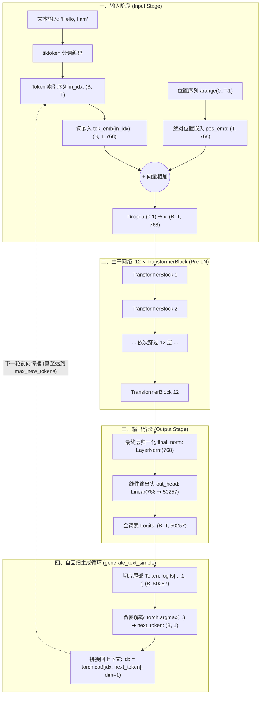
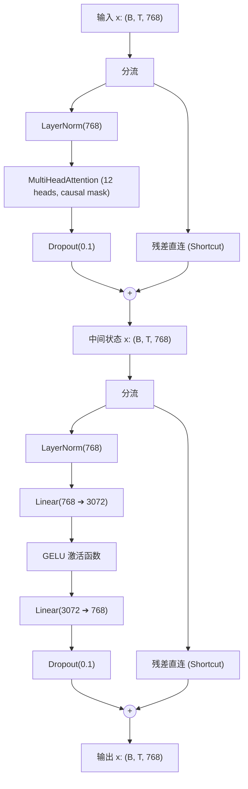

# GPT-2 Small (124M) 系统架构与逻辑结构技术文档

> **源码参考**：[`gtp2small.ipynb`](gtp2small.ipynb) / [`gpt2small.py`](gpt2small.py)  
> **相关参数文档**：[`gpt2 Small-parameters.md`](gpt2%20Small-parameters.md)  
> **交互式视窗**：[`gpt2-architecture-viewer.html`](gpt2-architecture-viewer.html) (可直接双击浏览器打开)  
> **静态与动态图表**：[`diagrams/gpt2small-architecture.svg`](diagrams/gpt2small-architecture.svg) · [`diagrams/gpt2small-architecture.html`](diagrams/gpt2small-architecture.html)

---

## 1. 架构总览与超参数规格

GPT-2 Small 是典型的**仅解码器（Decoder-only）因果语言模型**。其核心特点是采用 **Pre-LayerNorm** 结构以及带有**因果掩码（Causal Mask）**的多头自注意力机制。

### 1.1 模型基础超参 (`GPT_CONFIG_124M`)

```python
GPT_CONFIG_124M = {
    "vocab_size": 50257,     # BPE 词表大小
    "context_length": 1024,  # 最大上下文窗口（Token 数）
    "emb_dim": 768,          # 隐藏层特征维度 (d_model)
    "n_heads": 12,           # 注意力头数 (每头维度 head_dim = 768 / 12 = 64)
    "n_layers": 12,          # 堆叠的 TransformerBlock 块数
    "drop_rate": 0.1,        # Dropout 丢弃率
    "qkv_bias": False        # Q/K/V 投影是否启用偏置项
}
```

---

## 2. 系统层次与宏观数据流架构

GPT-2 的执行逻辑分为三大部分：**输入嵌入层（Input Embeddings）**、**12层堆叠的 Transformer 核心块（Core Backbone）**、以及**输出投影与自回归生成循环（Output Head & Generation Loop）**。

### 2.1 全局数据流流水线



---

## 3. 核心子模块逐层逻辑解析

### 3.1 双嵌入层 (`tok_emb` 与 `pos_emb`)

模型同时维护两个可学习的查找表矩阵：
- **词嵌入表** `tok_emb`：`nn.Embedding(50257, 768)`，将每个离散 token ID 映射为连续高维向量。
- **位置嵌入表** `pos_emb`：`nn.Embedding(1024, 768)`，为序列中的绝对索引位置赋予位置特征。

前向传播计算：
$$x = \text{Dropout}(\text{tok\_emb}(\text{in\_idx}) + \text{pos\_emb}(0, 1, \dots, T-1))$$

---

### 3.2 Transformer 核心块 (`TransformerBlock`)

GPT-2 采用 **Pre-LayerNorm** 架构设计，即“归一化放置在多头注意力和前馈网络之前”。残差分支（Shortcut Highway）贯穿前后，避免深层梯度弥散。



#### 数学表达：
1. **注意力子层**：
   $$x^{(1)} = x + \text{Dropout}(\text{MHA}(\text{LayerNorm}(x)))$$
2. **前馈子层**：
   $$x^{(2)} = x^{(1)} + \text{Dropout}(\text{FFN}(\text{LayerNorm}(x^{(1)})))$$

---

### 3.3 多头因果自注意力 (`MultiHeadAttention`)

该模块实现了自回归语言模型中最重要的**单向注意力限制**：

1. **Q/K/V 矩阵映射**：
   $$Q = x W_q, \quad K = x W_k, \quad V = x W_v \quad (W \in \mathbb{R}^{768 \times 768})$$
2. **多头切分与转置**：
   将最后一维重塑为 `(num_heads=12, head_dim=64)`，并置换为 `(B, 12, T, 64)`。
3. **点积注意力与上三角因果遮罩 (Causal Masking)**：
   计算注意力原始相关分：
   $$S = \frac{Q K^T}{\sqrt{d_k}} = \frac{Q K^T}{\sqrt{64}}$$
   上三角因果掩码将所有 $j > i$ 对应的注意力分数赋值为 $-\infty$：
   $$S_{i, j} = -\infty \quad (\forall j > i)$$
   经由 Softmax 后：
   $$A = \text{Softmax}(S, \text{dim}=-1)$$
   此时所有未来位置的注意力权重精确为 0，防止信息向前泄露。
4. **特征汇聚与输出投影**：
   $$\text{Context} = (A \cdot V) \xrightarrow{\text{转置并拼合}} (B, T, 768) \xrightarrow{W_{out}} (B, T, 768)$$

---

### 3.4 逐位置前馈网络 (`FeedForward`)

包含升维、非线性激活与降维两层全连接：
$$\text{FFN}(x) = \text{GELU}(x W_1 + b_1) W_2 + b_2$$
- 隐藏层放大系数为 4：$768 \to 3072 \to 768$。
- 使用 **GELU（高斯误差线性单元）**：相比普通 ReLU，GELU 在 0 附近平滑连续且有微弱负值响应，有利于深层特征学习。

---

### 3.5 最终规范化与分类头 (`final_norm` & `out_head`)

1. **final_norm**：`LayerNorm(768)` 对第 12 个 Block 输出的特征进行统一规范化。
2. **out_head**：`nn.Linear(768, 50257, bias=False)` 负责将特征向量投影到整个词表空间，输出未归一化的概率对数（Logits）。

---

### 3.6 自回归文本生成循环 (`generate_text_simple`)

推理阶段采用自回归贪婪解码：
1. **上下文截断**：`idx_cond = idx[:, -context_size:]`，确保进入模型的序列长度不超过 1024。
2. **模型推断**：`with torch.no_grad(): logits = model(idx_cond)`。
3. **末尾采样**：取序列最后一个时刻的分布 `logits[:, -1, :]`，经 `torch.argmax` 取得分最高的单个 Token ID。
4. **动态追加**：`idx = torch.cat((idx, idx_next), dim=1)`，将新生成的词拼接到输入，开启下一轮迭代。

---

## 4. 张量维度变换追踪表 (以 Notebook 输入为例)

在 Notebook 运行示例中，输入文本 `"Hello, I am"` 被分词为 4 个 Token，即 $B = 1, T = 4$：

| 执行步骤 | 处理模块 / 操作 | 输入形状 | 输出形状 | 备注说明 |
| :--- | :--- | :--- | :--- | :--- |
| **Step 1** | `tiktoken.encode` | 原始字符串 | `[15496, 11, 314, 716]` | 长度为 4 的整数列表 |
| **Step 2** | `unsqueeze(0)` | `(4,)` | `(1, 4)` | 增加批次维度 Batch=1 |
| **Step 3** | `tok_emb` 词嵌入 | `(1, 4)` | `(1, 4, 768)` | 每个 Token 映射为 768 维向量 |
| **Step 4** | `pos_emb` 位置嵌入 | `(4,)` | `(4, 768)` | 0, 1, 2, 3 绝对位置向量 |
| **Step 5** | 嵌入相加 + Dropout | `(1, 4, 768)` | `(1, 4, 768)` | 词义向量与位置向量逐元素相加 |
| **Step 6** | Block 内 Q/K/V 映射 | `(1, 4, 768)` | 3 个 `(1, 4, 768)` | 分别经由 `W_query, W_key, W_value` |
| **Step 7** | 多头重塑与转置 | `(1, 4, 768)` | `(1, 12, 4, 64)` | 拆分为 12 头，每头维度 64 |
| **Step 8** | 注意力打分矩阵 | $Q \times K^T$ | `(1, 12, 4, 4)` | 4×4 相似度矩阵，掩码遮蔽右上三角 |
| **Step 9** | 汇聚 $V$ 并转置拼合 | Weights $\times V$ | `(1, 4, 768)` | 12 个 64 维头拼接还原为 768 维 |
| **Step 10** | FFN 隐藏层升维 | `Linear(768, 3072)` | `(1, 4, 3072)` | 升维 4 倍后经 GELU 激活 |
| **Step 11** | FFN 降维恢复 | `Linear(3072, 768)` | `(1, 4, 768)` | 投影回 768 维并与残差相加 |
| **Step 12** | 12 层循环结束 | 穿透 12 个 Block | `(1, 4, 768)` | 保持序列特征维度稳定 |
| **Step 13** | `out_head` 输出映射 | `(1, 4, 768)` | `(1, 4, 50257)` | 词表全概率分布 (Logits) |
| **Step 14** | 截取末尾并采样 | `logits[:, -1, :]` | `(1, 1)` | 贪婪采样出下一个 Token ID |

---

## 5. 参数量分布与内存核算

| 模块组件 | 计算公式 | 参数量 (Parameters) | 占比 |
| :--- | :--- | :--- | :--- |
| **词嵌入 `tok_emb`** | $50257 \times 768$ | 38,597,376 | 23.68% |
| **位置嵌入 `pos_emb`** | $1024 \times 768$ | 786,432 | 0.48% |
| **注意力 Q/K/V (×12层)** | $12 \times (3 \times 768 \times 768)$ | 21,233,664 | 13.03% |
| **注意力 `out_proj` (×12层)** | $12 \times (768 \times 768 + 768)$ | 7,087,104 | 4.35% |
| **FFN 第 1 层升维 (×12层)** | $12 \times (768 \times 3072 + 3072)$ | 28,348,416 | 17.39% |
| **FFN 第 2 层降维 (×12层)** | $12 \times (3072 \times 768 + 768)$ | 28,320,768 | 17.37% |
| **Block 内 LayerNorm (×12层)** | $12 \times (2 \times 2 \times 768)$ | 36,864 | 0.02% |
| **最终 LayerNorm** | $2 \times 768$ | 1,536 | < 0.01% |
| **输出投影头 `out_head`** | $768 \times 50257$ | 38,597,376 | 23.68% |
| **未绑定权重总计** | - | **163,009,536 (≈ 163M)** | **100%** |
| **权重绑定 (Weight Tying)** | $163,009,536 - 38,597,376$ | **124,412,160 (≈ 124M)** | - |

> **说明**：原版 OpenAI GPT-2 启用了权重共享（Weight Tying），即令 `out_head.weight = tok_emb.weight`，从而免除了近 38.6M 的独立参数，这正是“GPT-2 Small 124M”名称的由来。在 Float32 精度下单模型权重占用内存从 **621.8 MiB** 降至 **474.6 MiB**。

---

## 6. 进阶改进与现代化建议

若希望在现有工程基础上进一步增强教学效果或提升模型现代工业级表现，建议参考以下 5 个方向：

### 6.1 Notebook 工程结构优化
1. **单元格模块化**：将当前单一大单元格解耦为 `01_配置`、`02_多头注意力`、`03_FFN与Block`、`04_主模型封装`、`05_自回归生成`，便于逐步断点调试。
2. **张量可视化与模型结构打印**：使用 `torchinfo` 库输出标准的参数与显存摘要：
   ```python
   from torchinfo import summary
   summary(model, input_size=(1, 4), dtypes=[torch.long])
   ```

### 6.2 现代化架构技术演进 (对标 Llama / Qwen)
1. **KV Cache (键值缓存加速生成)**：
   当前 `generate_text_simple` 每推断一个新词都要将整个前序序列重新传入模型做前向运算，计算复杂度为 $\mathcal{O}(N^2)$。引入 KV Cache 仅对新 Token 计算 $Q$，复用历史缓存的 $K$ 和 $V$，可将推理复杂度降至 $\mathcal{O}(N)$。
2. **旋转位置编码 (RoPE - Rotary Position Embedding)**：
   取代可学习的绝对位置嵌入 `pos_emb`。RoPE 具备相对位置感知能力以及长上下文外推潜力。
3. **RMSNorm 替代 LayerNorm**：
   省去 LayerNorm 中的均值统计与位移偏置（Shift），仅利用均方根做缩放，降低计算量并提升训练稳定性。
4. **SwiGLU 激活函数**：
   现代主流大模型将原有两层 FFN 改造为带门控机制的 SwiGLU 结构，在相同参数规模下显著提升语言表征能力。
5. **FlashAttention / PyTorch SDPA**：
   利用 `torch.nn.functional.scaled_dot_product_attention` 代替手写的矩阵乘法与 Softmax，充分利用 GPU SRAM 降低显存带宽吞吐瓶颈。
