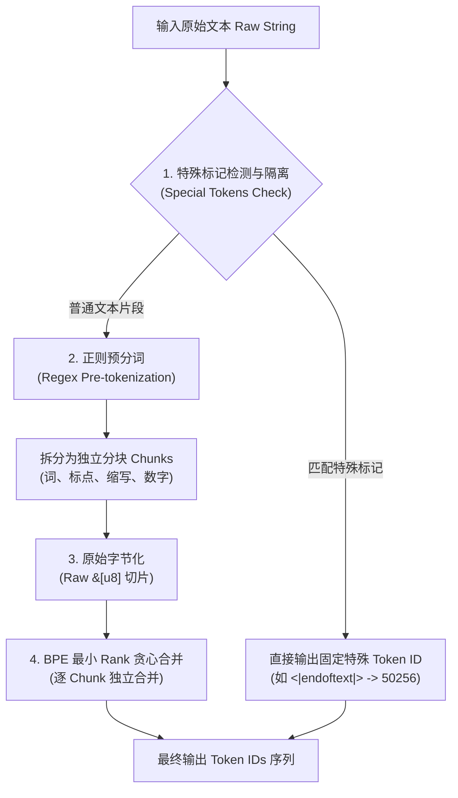

# Tiktoken 分词编码与底层架构技术解析文档

> **项目关联**：[`LLMs-from-scratch/gpt2`](file:///h:/LLM/BuildLLM/LLMs-from-scratch/gpt2)  
> **本地源码路径**：[`tiktoken/`](file:///h:/LLM/BuildLLM/LLMs-from-scratch/gpt2/tiktoken)  
> **核心引用文件**：[`gpt2small.py`](file:///h:/LLM/BuildLLM/LLMs-from-scratch/gpt2/gpt2small.py) / [`tiktoken/_educational.py`](file:///h:/LLM/BuildLLM/LLMs-from-scratch/gpt2/tiktoken/_educational.py)

---

## 目录
1. [项目集成与词库规格](#1-项目集成与词库规格)
2. [分词编码全流程细节](#2-分词编码全流程细节)
3. [核心算法细节：BPE 最小 Rank 贪心合并](#3-核心算法细节bpe-最小-rank-贪心合并)
4. [工程架构与源码结构](#4-工程架构与源码结构)
5. [性能内核：为什么 Tiktoken 极快](#5-性能内核为什么-tiktoken-极快)
6. [本地调试与学习指引](#6-本地调试与学习指引)

---

## 1. 项目集成与词库规格

当前工程实现了一个从零构建的 GPT-2 (124M) 模型。模型输入输出管线中的 Tokenizer 选型与词库配置如下：

### 1.1 词库基础信息
* **配置方式**：`tokenizer = tiktoken.get_encoding("gpt2")`
* **内部编码名称**：`r50k_base`
* **词表容量 (`vocab_size`)**：**`50257`**

### 1.2 词表容量构成公式
$$256 \text{ (基础单字节)} + 50,000 \text{ (BPE 学习合并 Token)} + 1 \text{ (特殊标记)} = 50,257$$

| 序号 | 组成部分 | Token ID 范围 | 说明 |
| :--- | :--- | :--- | :--- |
| **1** | **基础字节** | `0 ~ 255` | 覆盖单字节所有 256 种取值（`0x00 ~ 0xFF`），确保任意 Unicode/UTF-8 文本均可表达，**永远不会产生 `<unk>` 标记**。 |
| **2** | **BPE 合并项** | `256 ~ 50255` | 预训练阶段按出现频率由高到低迭代合并的 50,000 个高频字符对（如常用词、词根、前后缀）。 |
| **3** | **特殊标记** | `50256` | `<|endoftext|>`，用于标识文本序列的起始或截断。 |

### 1.3 模型维度对应关系
在 [`gpt2small.py`](file:///h:/LLM/BuildLLM/LLMs-from-scratch/gpt2/gpt2small.py#L192) 中，词表大小与神经网络两端严格对齐：
* **输入词嵌入**：`self.tok_emb = nn.Embedding(50257, 768)`
* **输出投影头**：`self.out_head = nn.Linear(768, 50257, bias=False)`

---

## 2. 分词编码全流程细节

`tiktoken` 处理文本分为四个清晰阶段：



### 步骤 1：特殊标记隔离与安全性拦截
* **参数机制**：接受 `allowed_special` 与 `disallowed_special` 两个集合。
* **安全性机制**：当普通用户输入中出现未显式声明允许的特殊标记（如 prompt 中包含 `<|endoftext|>`），会直接抛出安全异常，从分词层面防止 Prompt 注入攻击。

### 步骤 2：正则预分词（Pre-tokenization）
为了避免不同词性、标点或数字被混乱合并，`tiktoken` 强制先利用正则对文本切块，**且规定 BPE 合并绝对不能跨越正则切出的 Chunk 边界**。

* **GPT-2 官方切分正则**：
  ```regex
  's|'t|'re|'ve|'m|'ll|'d| ?\p{L}+| ?\p{N}+| ?[^\s\p{L}\p{N}]+|\s+(?!\S)|\s+
  ```
* **正则规则解析**：
  * `'s|'t|'re|...`：英文缩写词单独成块，优先切出。
  * ` ?\p{L}+`：匹配带有前导可选空格的连续字母单词（如 `" hello"`）。
  * ` ?\p{N}+`：匹配带有前导可选空格的连续数字。
  * ` ?[^\s\p{L}\p{N}]+`：匹配标点及非字母非数字符号（标点与单词被严格隔开）。
  * `\s+(?!\S)|\s+`：独立匹配空白字符。

### 步骤 3：Raw Bytes 字节化
传统的 Python GPT-2 实现中维护了一个复杂的 `bytes_to_unicode` 打印字符映射表。而 `tiktoken` **直接抛弃了 Unicode 中间映射**，直接将正则切出的每个 Chunk 转换为标准的 UTF-8 字节切片 `&[u8]`，并在字节级别进行查找。

---

## 3. 核心算法细节：BPE 最小 Rank 贪心合并

BPE 词表（`mergeable_ranks`）本质上是一个哈希表：`HashMap<Vec<u8>, usize>`，键为字节序列，值为合并排名（Rank）。
* **Rank 越小** $\implies$ 在训练集中出现频次越高 $\implies$ 拥有更高的合并优先级。

### 3.1 编码执行算法逻辑

对每个 Chunk 内部的原始字节序列执行以下迭代：
1. **初始化**：将 Chunk 的每一个字节拆解为单字节切片 `parts = [b0, b1, b2, ...]`.
2. **扫描相邻切片对**：计算当前序列中所有相邻切片在 `mergeable_ranks` 字典中的值：
   $$\text{min\_rank} = \min_{0 \le i < \text{len}-1} \text{ranks.get}(parts[i] + parts[i+1])$$
3. **判定与合并**：
   * 若所有相邻对均不在词表中（即 `min_rank` 为空），则该 Chunk 编码结束。
   * 否则，选出 **Rank 最小（优先级最高）** 的相邻对 $(parts[k], parts[k+1])$，就地合并为单一新切片。
4. **循环直到无法合并**。
5. **查表映射**：最终剩下的各个切片直接查 `ranks` 转换为对应的整型 Token ID。

### 3.2 纯 Python 对照实现源码分析

在当前项目内置的教学源码 [`tiktoken/_educational.py`](file:///h:/LLM/BuildLLM/LLMs-from-scratch/gpt2/tiktoken/_educational.py#L83-L116) 中，完整还原了这一算法：

```python
def bpe_encode(
    mergeable_ranks: dict[bytes, int], input: bytes, visualise: str | None = "colour"
) -> list[int]:
    # 1. 拆分为基础字节列表
    parts = [bytes([b]) for b in input]
    
    while True:
        min_idx = None
        min_rank = None
        # 2. 遍历相邻对，寻找当前切片中 Rank 最小的相邻对
        for i, pair in enumerate(zip(parts[:-1], parts[1:])):
            rank = mergeable_ranks.get(pair[0] + pair[1])
            if rank is not None and (min_rank is None or rank < min_rank):
                min_idx = i
                min_rank = rank

        # 3. 如果找不到任何可合并的对，说明已达到最简 token 粒度，合并完成
        if min_rank is None:
            break
        assert min_idx is not None

        # 4. 贪心合并该对，保持其余部分不变
        parts = parts[:min_idx] + [parts[min_idx] + parts[min_idx + 1]] + parts[min_idx + 2 :]

    # 5. 返回每个切片对应的 Token ID (即其最终 Rank)
    tokens = [mergeable_ranks[part] for part in parts]
    return tokens
```

---

## 4. 工程架构与源码结构

为了便于深度学习与调试，当前工程已将 `tiktoken` 源码完整平移至工程根目录下，项目文件树如下：

```text
LLMs-from-scratch/gpt2/
├── tiktoken/                           <-- 本地优先加载的源码包
│   ├── __init__.py                     <-- 包入口导出
│   ├── core.py                         <-- Python 封装层（Encoding 类）
│   ├── registry.py                     <-- 编码注册表（管理 "gpt2"、"cl100k_base"）
│   ├── load.py                         <-- 词表文件（.tiktoken）下载与缓存机制
│   ├── model.py                        <-- 模型名到编码名的映射
│   ├── _educational.py                 <-- 官方纯 Python 算法对照实现
│   └── _tiktoken.cp313-win_amd64.pyd   <-- Rust 编译的底层加速库（PyO3 绑定）
├── gpt2small.py                        <-- GPT-2 核心训练与生成脚本
└── gtp2small.ipynb                     <-- 交互式 Notebook
```

### 4.1 导入优先级机制
在 Python 中，当前工作目录与脚本所在目录默认位于 `sys.path[0]`。
因此在当前工程执行 `import tiktoken` 时，解释器会**自动优先加载本地 `./tiktoken/`**，覆盖系统的全局 `site-packages`。

验证代码：
```python
import tiktoken
print(tiktoken.__file__)
# 输出: H:\LLM\BuildLLM\LLMs-from-scratch\gpt2\tiktoken\__init__.py
```

### 4.2 动静态库与源码对应关系
* **`.pyd` 文件本质**：`_tiktoken.cp313-win_amd64.pyd` 是 Windows 上的动态链接库（DLL），由 Rust 代码通过 `PyO3` 框架编译而成，内部封装了 C-Python ABI。
* **原始 Rust 源码仓库**：[https://github.com/openai/tiktoken](https://github.com/openai/tiktoken)
  * 对应核心文件：`src/lib.rs`（包含核心 `CoreBPE` 结构体和底层 `_byte_pair_merge` 函数）。

---

## 5. 性能内核：为什么 Tiktoken 极快

相较于早期原版 Python 分词器或部分纯解释型库，`tiktoken` 拥有 5~30 倍的速度优势，核心来自以下底层工程优化：

1. **Rust 原生内存零拷贝**：
   无需在 Python 解释器和堆内存之间频繁创建字符串对象，直接基于原生字节数组切片 `&[u8]` 计算哈希与对比。
2. **多线程并发切分（Rayon 驱动）**：
   由于正则预分词切分出来的各个 Chunk 之间完全互不影响，Rust 内核利用 `rayon` 库，把整篇长文本中的不同 Chunk 自动并发分发到 CPU 多个物理核心上并行做 BPE 合并。
3. **基于索引跳跃的局部增量合并**：
   常规实现每次合并后重新扫描整串切片，复杂度为 $O(N^2)$。`tiktoken` 内部维护了类似双向链表的紧凑索引数组，合并某一位置 $(i, i+1)$ 后，仅需更新其前驱 $(i-1, i)$ 与后继 $(i, i+2)$ 的合并得分，避免全量重新扫描。

---

## 6. 本地调试与学习指引

拥有本地源码后，您可以非常方便地进行单步调试和内部机制观测：

### 技巧 1：开启算法可视化合并过程
在工程中直接调用教学模块，观测 `"Hello world"` 是如何一步步被字节合并的：

```python
from tiktoken._educational import SimpleBytePairEncoding
import tiktoken

# 从当前工程加载 gpt2 规则
enc = SimpleBytePairEncoding.from_tiktoken("gpt2")

# 开启可视化（将在控制台打印合并过程）
tokens = enc.encode("Hello world", visualise="simple")
print("Tokens:", tokens)
```

### 技巧 2：在 `core.py` 中追踪内部参数
在 [`tiktoken/core.py`](file:///h:/LLM/BuildLLM/LLMs-from-scratch/gpt2/tiktoken/core.py) 中的 `encode` 方法加入调试输出：
```python
def encode(self, text: str, *, allowed_special="all", disallowed_special=()):
    print(f"[Debug] Encoding text of length: {len(text)}")
    # ... 原有底层调用 ...
```
即可在不影响全局 Python 环境的前提下，深度观测工程训练和推理时的实际分词行为。
