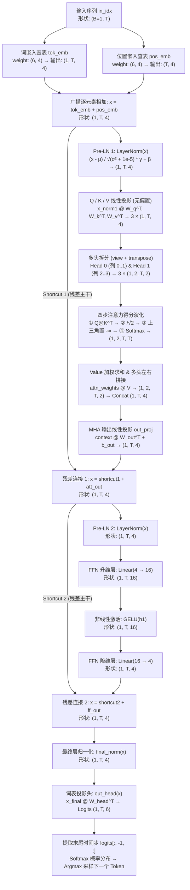

# GPT-2 Toy 全链路像素级深度剖析报告 (Complete Dissection Report)

> **自动生成说明**：本报告由 `gpt2toy.py` 实测运行并无损录制生成，固定随机种子 `torch.manual_seed(123)`，处于推断模式 (`model.eval()`, `drop_rate=0.0`)。所有矩阵与中间张量数值均为真实 PyTorch 前向传播精确结果。

## 目录 (Table of Contents)

1. [全局拓扑与张量维度演化图 (Architecture & Tensor Flow)](#1-全局拓扑与张量维度演化图)
2. [超参数规格与 312 个可学习参数精确拆解](#2-超参数规格与-312-个可学习参数精确拆解)
3. [全模块初始权重矩阵清单 (Initialized Weights)](#3-全模块初始权重矩阵清单)
4. [自回归 Step 1 全链路前向传播剖析 (`T=4`: `"Hello, I am"` → `"I"`)](#4-自回归-step-1-全链路前向传播剖析)
5. [自回归 Step 2 全链路前向传播剖析 (`T=5`: `"Hello, I am I"` → `"I"`)](#5-自回归-step-2-全链路前向传播剖析)
6. [跨步因果不变性验证 (KV Cache 核心原理) 与同词异位对比](#6-跨步因果不变性验证与同词异位对比)

---
## 1. 全局拓扑与张量维度演化图

---
## 2. 超参数规格与 312 个可学习参数精确拆解

### 2.1 模型超参数表与微型词表

| 超参数名称 | 取值 | 架构意义说明 |
| :--- | :---: | :--- |
| `vocab_size` (词表大小) | `6` | `'<|unk|>':0, '<|endoftext|>':1, 'Hello':2, ',':3, 'I':4, 'am':5` |
| `context_length` (最大上下文长度) | `6` | 位置嵌入表支持 `Pos = 0..5` |
| `emb_dim` (嵌入维度 $d_{\text{model}}$) | `4` | 主干残差流向量宽度为 4 维 |
| `n_heads` (注意力头数 $H$) | `2` | 每个头维度 $d_k = d_v = 4 / 2 = 2$ |
| `ffn_hidden_dim` (FFN 隐藏维 $4d$) | `16` | 前馈网络升维至 $4 \times 4 = 16$ 维 |
| `n_layers` (Transformer 层数) | `1` | 包含 1 个完整的 `TransformerBlock` |
| `qkv_bias` / `drop_rate` | `False` / `0.0` | Q/K/V 线性层无偏置，推断模式关闭 Dropout |

### 2.2 全模块可学习参数量实测分布

| 所属阶段 | 模块 / 参数张量 | 权重形状 | 含 Bias | 参数量 |
| :--- | :--- | :---: | :---: | ---: |
| 1. 输入嵌入阶段 | `tok_emb.weight` | `(6, 4)` | `False` | `24` |
| 1. 输入嵌入阶段 | `pos_emb.weight` | `(6, 4)` | `False` | `24` |
| 2. TransformerBlock 0 | `norm1` (`scale` + `shift`) | `(4,) + (4,)` | — | `8` |
| 2. TransformerBlock 0 | `att.W_query / W_key / W_value` | `3 × (4, 4)` | `False` | `48` |
| 2. TransformerBlock 0 | `att.out_proj` (`weight` + `bias`) | `(4, 4) + (4,)` | `True` | `20` |
| 2. TransformerBlock 0 | `norm2` (`scale` + `shift`) | `(4,) + (4,)` | — | `8` |
| 2. TransformerBlock 0 | `ff.layers[0]` (升维 `4→16`) | `(16, 4) + (16,)` | `True` | `80` |
| 2. TransformerBlock 0 | `ff.layers[2]` (降维 `16→4`) | `(4, 16) + (4,)` | `True` | `68` |
| 3. 输出预测阶段 | `final_norm` (`scale` + `shift`) | `(4,) + (4,)` | — | `8` |
| 3. 输出预测阶段 | `out_head.weight` (词表投影) | `(6, 4)` | `False` | `24` |
| **全模型总计 (Total)** | **所有可学习参数** | **Float32 占 1248 Bytes** | — | **`312`** |

---
## 3. 全模块初始权重矩阵清单 (Initialized Weights)

> **注意**：PyTorch 中 `nn.Linear(in_features, out_features)` 的 `.weight` 存储形状为 `(out_features, in_features)`，前向计算公式为 $y = x W^T + b$。

### 3.1 词嵌入表 `tok_emb.weight` `(6 × 4)` 与 位置嵌入表 `pos_emb.weight` `(6 × 4)`

**词嵌入查找表 `tok_emb.weight` (行号即 Token ID)：**

| Token ID (词元) | Dim 0 | Dim 1 | Dim 2 | Dim 3 |
| :--- | ---: | ---: | ---: | ---: |
| `ID=0` (`'<|unk|>'`) | 0.3374 | -0.1778 | -0.3035 | -0.5880 |
| `ID=1` (`'<|endoftext|>'`) | 0.3486 | 0.6603 | -0.2196 | -0.3792 |
| `ID=2` (`'Hello'`) | -0.1606 | -0.4015 | 0.6957 | -1.8061 |
| `ID=3` (`','`) | 1.8960 | -0.1750 | 1.3689 | -1.6033 |
| `ID=4` (`'I'`) | -0.7849 | -1.4096 | -0.4076 | 0.7953 |
| `ID=5` (`'am'`) | 0.9985 | 0.2212 | 1.8319 | -0.3378 |

**位置嵌入查找表 `pos_emb.weight` (行号即序列位置 `0..5`)：**

| 位置索引 Pos | Dim 0 | Dim 1 | Dim 2 | Dim 3 |
| :--- | ---: | ---: | ---: | ---: |
| `Pos=0` | 0.9624 | 0.2492 | -0.4845 | -2.0929 |
| `Pos=1` | -0.8199 | -0.4210 | -0.9620 | 1.2825 |
| `Pos=2` | 0.5146 | 0.9938 | -0.2587 | -1.0826 |
| `Pos=3` | -0.0444 | 1.6236 | -2.3229 | 1.0878 |
| `Pos=4` | 0.6716 | 0.6933 | -0.9487 | -0.0765 |
| `Pos=5` | -0.1526 | 0.1167 | 0.4403 | -1.4465 |

### 3.2 `TransformerBlock 0` 内部权重矩阵

- **`norm1` (Pre-LN 1)**: `scale` = `[1.0000, 1.0000, 1.0000, 1.0000]`, `shift` = `[0.0000, 0.0000, 0.0000, 0.0000]`

- **`norm2` (Pre-LN 2)**: `scale` = `[1.0000, 1.0000, 1.0000, 1.0000]`, `shift` = `[0.0000, 0.0000, 0.0000, 0.0000]`

**Query 投影矩阵 `att.W_query.weight` `(4 × 4)`**（前 2 行归属 `Head 0`，后 2 行归属 `Head 1`）：

| 输出维度 (归属头) | InDim 0 | InDim 1 | InDim 2 | InDim 3 |
| :--- | ---: | ---: | ---: | ---: |
| `OutDim 0` (`Head 0, d0`) | 0.2320 | 0.0183 | 0.0983 | -0.0473 |
| `OutDim 1` (`Head 0, d1`) | -0.2749 | -0.1889 | -0.3045 | 0.4153 |
| `OutDim 2` (`Head 1, d0`) | 0.2751 | 0.1749 | -0.3834 | 0.3858 |
| `OutDim 3` (`Head 1, d1`) | 0.1568 | 0.3459 | -0.1967 | 0.1060 |

**Key 投影矩阵 `att.W_key.weight` `(4 × 4)`**（前 2 行归属 `Head 0`，后 2 行归属 `Head 1`）：

| 输出维度 (归属头) | InDim 0 | InDim 1 | InDim 2 | InDim 3 |
| :--- | ---: | ---: | ---: | ---: |
| `OutDim 0` (`Head 0, d0`) | 0.4882 | 0.3363 | 0.4010 | -0.1050 |
| `OutDim 1` (`Head 0, d1`) | 0.3809 | -0.3916 | 0.0432 | -0.2815 |
| `OutDim 2` (`Head 1, d0`) | -0.1166 | -0.1280 | 0.0374 | 0.4551 |
| `OutDim 3` (`Head 1, d1`) | 0.2475 | -0.0021 | 0.3549 | -0.2562 |

**Value 投影矩阵 `att.W_value.weight` `(4 × 4)`**（前 2 行归属 `Head 0`，后 2 行归属 `Head 1`）：

| 输出维度 (归属头) | InDim 0 | InDim 1 | InDim 2 | InDim 3 |
| :--- | ---: | ---: | ---: | ---: |
| `OutDim 0` (`Head 0, d0`) | 0.2577 | -0.0464 | -0.0870 | 0.0585 |
| `OutDim 1` (`Head 0, d1`) | -0.3830 | 0.0578 | 0.1681 | 0.4275 |
| `OutDim 2` (`Head 1, d0`) | -0.1557 | 0.1800 | 0.4998 | -0.2145 |
| `OutDim 3` (`Head 1, d1`) | 0.4753 | -0.2482 | 0.2204 | 0.1959 |

**多头输出投影层 `att.out_proj.weight` `(4 × 4)` 与 `bias` `(4,)`：**

| 输出维度 | InDim 0 (H0,d0) | InDim 1 (H0,d1) | InDim 2 (H1,d0) | InDim 3 (H1,d1) | Bias |
| :--- | ---: | ---: | ---: | ---: | ---: |
| `OutDim 0` | 0.1397 | 0.3954 | -0.2021 | 0.1314 | 0.0757 |
| `OutDim 1` | 0.0028 | -0.3761 | -0.1214 | -0.3339 | -0.2215 |
| `OutDim 2` | 0.2211 | 0.0449 | 0.0490 | -0.1517 | -0.3054 |
| `OutDim 3` | 0.0024 | -0.1555 | 0.1437 | 0.4856 | 0.0382 |

<b>点击展开查看 FFN 升维层 (16×4) 与 降维层 (4×16) 完整权重表</b>

**FFN 升维层 `ff.layers[0].weight` `(16 × 4)` 与 `bias` `(16,)`：**

| 隐藏维索引 | InDim 0 | InDim 1 | InDim 2 | InDim 3 | Bias |
| :--- | ---: | ---: | ---: | ---: | ---: |
| `HidDim 00` | -0.3709 | -0.3758 | -0.3254 | -0.1698 | 0.2056 |
| `HidDim 01` | 0.0370 | 0.3443 | 0.1937 | 0.3831 | -0.3147 |
| `HidDim 02` | -0.3139 | 0.0422 | -0.4444 | 0.2868 | 0.1339 |
| `HidDim 03` | 0.1042 | 0.4836 | -0.3556 | 0.4010 | -0.1106 |
| `HidDim 04` | 0.4221 | 0.4043 | 0.0713 | 0.4546 | 0.2398 |
| `HidDim 05` | 0.3339 | 0.3730 | -0.0325 | -0.3837 | -0.2712 |
| `HidDim 06` | -0.0062 | 0.0938 | -0.3406 | -0.2868 | 0.0185 |
| `HidDim 07` | -0.4794 | -0.1753 | 0.4355 | 0.0855 | 0.0489 |
| `HidDim 08` | -0.0305 | 0.0201 | 0.3118 | -0.4415 | -0.4023 |
| `HidDim 09` | -0.3858 | -0.1662 | -0.2878 | 0.2579 | -0.3636 |
| `HidDim 10` | 0.3533 | -0.4851 | -0.4243 | -0.4869 | 0.1918 |
| `HidDim 11` | 0.1886 | 0.4024 | -0.3877 | -0.2315 | -0.1455 |
| `HidDim 12` | 0.1591 | -0.3265 | 0.4247 | 0.1166 | 0.2969 |
| `HidDim 13` | -0.1392 | 0.0325 | 0.1559 | -0.1768 | -0.4939 |
| `HidDim 14` | -0.3874 | 0.0034 | 0.0091 | 0.0101 | -0.2472 |
| `HidDim 15` | -0.0730 | 0.3210 | -0.1395 | -0.0484 | -0.4118 |

**FFN 降维层 `ff.layers[2].weight` `(4 × 16)` 与 `bias` `(4,)`：**

| 输出维度 | InDim [00..07] | InDim [08..15] | Bias |
| :--- | :--- | :--- | ---: |
| `OutDim 0` | [0.0999, -0.0072, -0.0466, -0.0416, -0.1954, 0.0709, 0.0062, -0.1725] | [0.0941, -0.0050, -0.2418, 0.1345, 0.1337, -0.0471, -0.1726, 0.0100] | 0.2084 |
| `OutDim 1` | [0.1886, 0.2288, -0.1887, -0.1129, 0.1947, 0.1222, 0.1548, -0.1244] | [0.2154, -0.2055, -0.0120, 0.0052, 0.0420, -0.1886, 0.2294, 0.2457] | -0.0431 |
| `OutDim 2` | [-0.1727, 0.0092, -0.1332, 0.2397, 0.1394, 0.1472, 0.0807, -0.0249] | [0.1408, 0.0043, -0.0912, 0.1291, 0.0785, -0.0648, -0.0685, -0.2211] | -0.0319 |
| `OutDim 3` | [-0.0685, -0.1013, -0.1363, -0.2258, 0.1958, -0.2234, 0.2482, -0.1311] | [-0.0192, 0.2039, 0.0825, -0.0714, -0.2013, -0.1022, 0.2013, -0.0944] | 0.0998 |

### 3.3 最终归一化 `final_norm` 与 词表输出头 `out_head.weight` `(6 × 4)`

- **`final_norm`**: `scale` = `[1.0000, 1.0000, 1.0000, 1.0000]`, `shift` = `[0.0000, 0.0000, 0.0000, 0.0000]`

| 预测目标词表项 | InDim 0 | InDim 1 | InDim 2 | InDim 3 |
| :--- | ---: | ---: | ---: | ---: |
| `ID=0` (`'<|unk|>'`) | -0.0735 | -0.0042 | 0.3463 | 0.1671 |
| `ID=1` (`'<|endoftext|>'`) | -0.0199 | 0.1904 | 0.4355 | 0.1260 |
| `ID=2` (`'Hello'`) | -0.1466 | 0.1638 | -0.0437 | -0.3909 |
| `ID=3` (`','`) | -0.1931 | 0.2274 | 0.0164 | 0.1845 |
| `ID=4` (`'I'`) | -0.2927 | 0.4727 | -0.2087 | 0.1066 |
| `ID=5` (`'am'`) | -0.2443 | -0.2412 | 0.2239 | -0.1396 |

---
## 4. 自回归 Step 1 全链路前向传播剖析

- **当前步骤输入文本**: `"Hello, I am"`

- **输入 Token IDs (`in_idx`)**: `[2, 3, 4, 5]` (形状 `(B=1, T=4)`)

- **位置编号 (`pos_indices`)**: `[0, 1, 2, 3]`

### 4.1 阶段一：输入嵌入查表与广播相加 (`Input Embeddings`)

计算公式：
$$X_{t, d} = W_{\text{tok}}[\text{in\_idx}_t, d] + W_{\text{pos}}[t, d]$$

| 序列位置 Token | 词嵌入查表 `tok_emb[ID]` | 位置嵌入查表 `pos_emb[Pos]` | 融合结果 `x = tok + pos` |
| :--- | :--- | :--- | :--- |
| `t0[ID=2:'Hello']` | `tok_emb[2]` = `[-0.1606, -0.4015, 0.6957, -1.8061]` | `pos_emb[0]` = `[0.9624, 0.2492, -0.4845, -2.0929]` | `[0.8019, -0.1523, 0.2112, -3.8990]` |
| `t1[ID=3:',']` | `tok_emb[3]` = `[1.8960, -0.1750, 1.3689, -1.6033]` | `pos_emb[1]` = `[-0.8199, -0.4210, -0.9620, 1.2825]` | `[1.0761, -0.5961, 0.4069, -0.3208]` |
| `t2[ID=4:'I']` | `tok_emb[4]` = `[-0.7849, -1.4096, -0.4076, 0.7953]` | `pos_emb[2]` = `[0.5146, 0.9938, -0.2587, -1.0826]` | `[-0.2702, -0.4158, -0.6664, -0.2872]` |
| `t3[ID=5:'am']` | `tok_emb[5]` = `[0.9985, 0.2212, 1.8319, -0.3378]` | `pos_emb[3]` = `[-0.0444, 1.6236, -2.3229, 1.0878]` | `[0.9542, 1.8448, -0.4910, 0.7500]` |

### 4.2 阶段二：`Pre-LN 1 (norm1)` 内部统计量与归一化验算

对每个 Token 的 4 维向量独立求均值 $\mu_t = \frac{1}{4}\sum_{d=0}^3 x_{t,d}$ 与有偏方差 $\sigma^2_t = \frac{1}{4}\sum_{d=0}^3 (x_{t,d}-\mu_t)^2$，再执行标准化 $\hat{x}_{t,d} = \frac{x_{t,d} - \mu_t}{\sqrt{\sigma^2_t + 10^{-5}}}$：

| Token | 输入向量 `x` | 均值 `μ` | 有偏方差 `σ²` | 分母 `√(σ²+ε)` | 归一化输出 `x_norm1` | 后验校验 |
| :--- | :--- | ---: | ---: | ---: | :--- | :---: |
| `t0[ID=2:'Hello']` | `[0.8019, -0.1523, 0.2112, -3.8990]` | -0.7595 | 3.4013 | 1.8443 | `[0.8466, 0.3293, 0.5264, -1.7023]` | `μ'=0.0000, σ'²=1.0000` |
| `t1[ID=3:',']` | `[1.0761, -0.5961, 0.4069, -0.3208]` | 0.1415 | 0.4254 | 0.6522 | `[1.4328, -1.1309, 0.4069, -0.7088]` | `μ'=0.0000, σ'²=1.0000` |
| `t2[ID=4:'I']` | `[-0.2702, -0.4158, -0.6664, -0.2872]` | -0.4099 | 0.0251 | 0.1584 | `[0.8816, -0.0373, -1.6187, 0.7743]` | `μ'=0.0000, σ'²=0.9996` |
| `t3[ID=5:'am']` | `[0.9542, 1.8448, -0.4910, 0.7500]` | 0.7645 | 0.6949 | 0.8336 | `[0.2275, 1.2960, -1.5061, -0.0174]` | `μ'=-0.0000, σ'²=1.0000` |

### 4.3 阶段三：因果多头注意力 (`MultiHeadAttention`) 全链路显微镜

#### (4.3.1) 切头前完整 4 维线性映射 vs 多头切分 (`Head 0` & `Head 1`)

线性变换 $Q = X_{\text{norm1}} W_Q^T,\; K = X_{\text{norm1}} W_K^T,\; V = X_{\text{norm1}} W_V^T$ 输出形状均为 `(1, T, 4)`。随后 `view(1, T, 2, 2).transpose(1, 2)` 将前 2 列划归 `Head 0`，后 2 列划归 `Head 1`：

| Token | `Q_full (4维)` | `Q_Head0` | `Q_Head1` | `K_Head0` | `K_Head1` | `V_Head0` | `V_Head1` |
| :--- | :--- | :--- | :--- | :--- | :--- | :--- | :--- |
| `t0[ID=2:'Hello']` | `[0.3347, -1.1622, -0.5681, -0.0374]` | `[0.3347, -1.1622]` | `[-0.5681, -0.0374]` | `[0.9139, 0.6956]` | `[-0.8958, 0.8319]` | `[0.0575, -0.9444]` | `[0.5556, 0.1032]` |
| `t1[ID=3:',']` | `[0.3853, -0.5985, -0.2330, -0.3217]` | `[0.3853, -0.5985]` | `[-0.2330, -0.3217]` | `[0.5567, 1.2058]` | `[-0.3296, 0.6831]` | `[0.3448, -0.8488]` | `[-0.0712, 0.9126]` |
| `t2[ID=4:'I']` | `[0.0080, 0.5791, 1.1555, 0.5258]` | `[0.0080, 0.5791]` | `[1.1555, 0.5258]` | `[-0.3125, 0.0624]` | `[0.1938, -0.5546]` | `[0.4151, -0.2810]` | `[-1.1190, 0.2232]` |
| `t3[ID=5:'am']` | `[-0.0708, 0.1439, 0.8600, 0.7783]` | `[-0.0708, 0.1439]` | `[0.8600, 0.7783]` | `[-0.0552, -0.4811]` | `[-0.2567, -0.4765]` | `[0.1286, -0.2729]` | `[-0.5511, -0.5489]` |

#### (4.3.2) 注意力得分矩阵四步演化 (`Raw` → `Scaled` → `Masked` → `Softmax`)

缩放因子 $\sqrt{d_k} = \sqrt{2} \approx 1.4142$。因果掩码将上三角区域 ($j > i$，即未来位置) 置为 $-\infty$，使得 $\text{softmax}$ 后未来位置权重严格为 `0.0000`：

**【Head 0】四步注意力矩阵 (`4 × 4`)：**

- **① 原始点积得分 `raw_scores = Q_0 @ K_0^T`**：

| Query 位置 \ Key 位置 | `t0` (`'Hello'`) | `t1` (`','`) | `t2` (`'I'`) | `t3` (`'am'`) |
| :--- | ---: | ---: | ---: | ---: |
| `t0[ID=2:'Hello']` | -0.5025 | -1.2151 | -0.1772 | 0.5406 |
| `t1[ID=3:',']` | -0.0642 | -0.5072 | -0.1578 | 0.2667 |
| `t2[ID=4:'I']` | 0.4102 | 0.7028 | 0.0337 | -0.2790 |
| `t3[ID=5:'am']` | 0.0354 | 0.1342 | 0.0311 | -0.0653 |

- **② 缩放得分 `unmasked_scaled = raw_scores / √2`**：

| Query 位置 \ Key 位置 | `t0` (`'Hello'`) | `t1` (`','`) | `t2` (`'I'`) | `t3` (`'am'`) |
| :--- | ---: | ---: | ---: | ---: |
| `t0[ID=2:'Hello']` | -0.3553 | -0.8592 | -0.1253 | 0.3823 |
| `t1[ID=3:',']` | -0.0454 | -0.3587 | -0.1116 | 0.1886 |
| `t2[ID=4:'I']` | 0.2900 | 0.4970 | 0.0238 | -0.1973 |
| `t3[ID=5:'am']` | 0.0250 | 0.0949 | 0.0220 | -0.0462 |

- **③ 因果掩码遮蔽后得分 `masked_scores` ($j > i$ 置为 $-\infty$)**：

| Query 位置 \ Key 位置 | `t0` (`'Hello'`) | `t1` (`','`) | `t2` (`'I'`) | `t3` (`'am'`) |
| :--- | ---: | ---: | ---: | ---: |
| `t0[ID=2:'Hello']` | -0.3553 | -∞ | -∞ | -∞ |
| `t1[ID=3:',']` | -0.0454 | -0.3587 | -∞ | -∞ |
| `t2[ID=4:'I']` | 0.2900 | 0.4970 | 0.0238 | -∞ |
| `t3[ID=5:'am']` | 0.0250 | 0.0949 | 0.0220 | -0.0462 |

- **④ Softmax 归一化注意力权重 `attn_weights` (每行概率和 = `1.0000`)**：

| Query 位置 \ Key 位置 | `t0` (`'Hello'`) | `t1` (`','`) | `t2` (`'I'`) | `t3` (`'am'`) |
| :--- | ---: | ---: | ---: | ---: |
| `t0[ID=2:'Hello']` | 1.0000 | 0.0000 | 0.0000 | 0.0000 |
| `t1[ID=3:',']` | 0.5777 | 0.4223 | 0.0000 | 0.0000 |
| `t2[ID=4:'I']` | 0.3338 | 0.4105 | 0.2557 | 0.0000 |
| `t3[ID=5:'am']` | 0.2500 | 0.2680 | 0.2492 | 0.2328 |

**【Head 1】四步注意力矩阵 (`4 × 4`)：**

- **① 原始点积得分 `raw_scores = Q_1 @ K_1^T`**：

| Query 位置 \ Key 位置 | `t0` (`'Hello'`) | `t1` (`','`) | `t2` (`'I'`) | `t3` (`'am'`) |
| :--- | ---: | ---: | ---: | ---: |
| `t0[ID=2:'Hello']` | 0.4778 | 0.1617 | -0.0894 | 0.1636 |
| `t1[ID=3:',']` | -0.0589 | -0.1430 | 0.1333 | 0.2131 |
| `t2[ID=4:'I']` | -0.5977 | -0.0217 | -0.0677 | -0.5472 |
| `t3[ID=5:'am']` | -0.1229 | 0.2482 | -0.2650 | -0.5917 |

- **② 缩放得分 `unmasked_scaled = raw_scores / √2`**：

| Query 位置 \ Key 位置 | `t0` (`'Hello'`) | `t1` (`','`) | `t2` (`'I'`) | `t3` (`'am'`) |
| :--- | ---: | ---: | ---: | ---: |
| `t0[ID=2:'Hello']` | 0.3379 | 0.1144 | -0.0632 | 0.1157 |
| `t1[ID=3:',']` | -0.0416 | -0.1011 | 0.0942 | 0.1507 |
| `t2[ID=4:'I']` | -0.4227 | -0.0153 | -0.0479 | -0.3869 |
| `t3[ID=5:'am']` | -0.0869 | 0.1755 | -0.1874 | -0.4184 |

- **③ 因果掩码遮蔽后得分 `masked_scores` ($j > i$ 置为 $-\infty$)**：

| Query 位置 \ Key 位置 | `t0` (`'Hello'`) | `t1` (`','`) | `t2` (`'I'`) | `t3` (`'am'`) |
| :--- | ---: | ---: | ---: | ---: |
| `t0[ID=2:'Hello']` | 0.3379 | -∞ | -∞ | -∞ |
| `t1[ID=3:',']` | -0.0416 | -0.1011 | -∞ | -∞ |
| `t2[ID=4:'I']` | -0.4227 | -0.0153 | -0.0479 | -∞ |
| `t3[ID=5:'am']` | -0.0869 | 0.1755 | -0.1874 | -0.4184 |

- **④ Softmax 归一化注意力权重 `attn_weights` (每行概率和 = `1.0000`)**：

| Query 位置 \ Key 位置 | `t0` (`'Hello'`) | `t1` (`','`) | `t2` (`'I'`) | `t3` (`'am'`) |
| :--- | ---: | ---: | ---: | ---: |
| `t0[ID=2:'Hello']` | 1.0000 | 0.0000 | 0.0000 | 0.0000 |
| `t1[ID=3:',']` | 0.5149 | 0.4851 | 0.0000 | 0.0000 |
| `t2[ID=4:'I']` | 0.2527 | 0.3797 | 0.3676 | 0.0000 |
| `t3[ID=5:'am']` | 0.2549 | 0.3315 | 0.2306 | 0.1830 |

#### (4.3.3) Value 加权求和、多头左右拼接与 `out_proj` 输出线性投影

每个头独立计算 $\text{context}_h = \text{attn\_weights}_h V_h \in \mathbb{R}^{T \times 2}$，随后左右拼接为 $\text{context}_{\text{merged}} = [\text{context}_0 \,\|\, \text{context}_1] \in \mathbb{R}^{T \times 4}$，最后经 `out_proj` 映射为 `att_out`：

| Token | `Head 0 Context (2维)` | `Head 1 Context (2维)` | 多头拼接 `Concat (4维)` | 投影输出 `att_out (4维)` |
| :--- | :--- | :--- | :--- | :--- |
| `t0[ID=2:'Hello']` | `[0.0575, -0.9444]` | `[0.5556, 0.1032]` | `[0.0575, -0.9444, 0.5556, 0.1032]` | `[-0.3884, 0.0319, -0.3236, 0.3152]` |
| `t1[ID=3:',']` | `[0.1788, -0.9040]` | `[0.2515, 0.4959]` | `[0.1788, -0.9040, 0.2515, 0.4959]` | `[-0.2424, -0.0771, -0.3694, 0.4562]` |
| `t2[ID=4:'I']` | `[0.2669, -0.7355]` | `[-0.2980, 0.4547]` | `[0.2669, -0.7355, -0.2980, 0.4547]` | `[-0.0578, -0.0598, -0.3630, 0.3312]` |
| `t3[ID=5:'am']` | `[0.2401, -0.5971]` | `[-0.2408, 0.2798]` | `[0.2401, -0.5971, -0.2408, 0.2798]` | `[-0.0414, -0.0604, -0.3334, 0.2329]` |

### 4.4 阶段四：残差连接 1 (`Shortcut 1`: `x = shortcut1 + att_out`)

| Token | 主干输入 `shortcut1` | 子层增量 `att_out` | 残差融合输出 `x_res1` |
| :--- | :--- | :--- | :--- |
| `t0[ID=2:'Hello']` | `[0.8019, -0.1523, 0.2112, -3.8990]` | `[-0.3884, 0.0319, -0.3236, 0.3152]` | `[0.4135, -0.1203, -0.1124, -3.5838]` |
| `t1[ID=3:',']` | `[1.0761, -0.5961, 0.4069, -0.3208]` | `[-0.2424, -0.0771, -0.3694, 0.4562]` | `[0.8336, -0.6732, 0.0375, 0.1354]` |
| `t2[ID=4:'I']` | `[-0.2702, -0.4158, -0.6664, -0.2872]` | `[-0.0578, -0.0598, -0.3630, 0.3312]` | `[-0.3281, -0.4756, -1.0294, 0.0440]` |
| `t3[ID=5:'am']` | `[0.9542, 1.8448, -0.4910, 0.7500]` | `[-0.0414, -0.0604, -0.3334, 0.2329]` | `[0.9128, 1.7844, -0.8244, 0.9829]` |

### 4.5 阶段五：`Pre-LN 2 (norm2)` → 前馈网络 (`FFN`) → 残差连接 2 (`Shortcut 2`)

**(1) `Pre-LN 2 (norm2)` 统计量与归一化输出：**

| Token | 均值 `μ` | 方差 `σ²` | 标准差 `std` | 归一化输出 `x_norm2` |
| :--- | ---: | ---: | ---: | :--- |
| `t0[ID=2:'Hello']` | -0.8508 | 2.5366 | 1.5927 | `[0.7938, 0.4586, 0.4636, -1.7160]` |
| `t1[ID=3:',']` | 0.0833 | 0.2850 | 0.5339 | `[1.4054, -1.4170, -0.0859, 0.0975]` |
| `t2[ID=4:'I']` | -0.4473 | 0.1488 | 0.3858 | `[0.3090, -0.0734, -1.5090, 1.2735]` |
| `t3[ID=5:'am']` | 0.7139 | 0.9060 | 0.9519 | `[0.2089, 1.1246, -1.6161, 0.2826]` |

**(2) `FFN` 升维 (`4→16`)、GELU 激活与降维 (`16→4`) 输出：**

| Token | 升维 `fc1_out` (前4维预览) | 激活 `GELU(fc1)` (前4维预览) | 降维输出 `ff_out (4维)` |
| :--- | :--- | :--- | :--- |
| `t0[ID=2:'Hello']` | `[-0.1207, -0.6950, -0.7942, -0.6590] ...` (共16维) | `[-0.0545, -0.1693, -0.1697, -0.1681] ...` (共16维) | `[0.2329, 0.1415, 0.1473, 0.0838]` |
| `t1[ID=3:',']` | `[0.2282, -0.7299, -0.3010, -0.5798] ...` (共16维) | `[0.1347, -0.1699, -0.1149, -0.1630] ...` (共16维) | `[0.0205, -0.0169, -0.1097, 0.1507]` |
| `t2[ID=4:'I']` | `[0.3934, -0.1330, 1.0697, 0.9334] ...` (共16维) | `[0.2569, -0.0595, 0.9173, 0.7696] ...` (共16维) | `[0.0203, -0.2224, 0.0803, 0.0590]` |
| `t3[ID=5:'am']` | `[0.1834, -0.1245, 0.9151, 1.1431] ...` (共16维) | `[0.1050, -0.0561, 0.7502, 0.9983] ...` (共16维) | `[0.1114, -0.0773, 0.2751, -0.0260]` |

**(3) 残差连接 2 (`x_block_out = shortcut2 + ff_out`) 三列对照：**

| Token | 主干输入 `shortcut2 (x_res1)` | 子层增量 `ff_out` | Block 最终输出 `x_block_out` |
| :--- | :--- | :--- | :--- |
| `t0[ID=2:'Hello']` | `[0.4135, -0.1203, -0.1124, -3.5838]` | `[0.2329, 0.1415, 0.1473, 0.0838]` | `[0.6464, 0.0212, 0.0349, -3.5000]` |
| `t1[ID=3:',']` | `[0.8336, -0.6732, 0.0375, 0.1354]` | `[0.0205, -0.0169, -0.1097, 0.1507]` | `[0.8541, -0.6901, -0.0722, 0.2861]` |
| `t2[ID=4:'I']` | `[-0.3281, -0.4756, -1.0294, 0.0440]` | `[0.0203, -0.2224, 0.0803, 0.0590]` | `[-0.3078, -0.6980, -0.9491, 0.1030]` |
| `t3[ID=5:'am']` | `[0.9128, 1.7844, -0.8244, 0.9829]` | `[0.1114, -0.0773, 0.2751, -0.0260]` | `[1.0241, 1.7071, -0.5493, 0.9569]` |

### 4.6 阶段六：最终层归一化 (`final_norm`)、词表 Logits 投影与采样决策

| Token | 均值 `μ` | 方差 `σ²` | `final_norm` 输出 `(4维)` | 词表 Logits `out_head(x)` `(6维)` |
| :--- | ---: | ---: | :--- | :--- |
| `t0[ID=2:'Hello']` | -0.6994 | 2.6782 | `[0.8223, 0.4403, 0.4487, -1.7113]` | `[-0.1929, 0.0472, 0.6009, -0.3670, -0.3086, 0.0322]` |
| `t1[ID=3:',']` | 0.0945 | 0.3143 | `[1.3550, -1.3995, -0.2974, 0.3418]` | `[-0.1395, -0.3799, -0.5486, -0.5217, -0.9595, -0.1078]` |
| `t2[ID=4:'I']` | -0.4630 | 0.1590 | `[0.3891, -0.5894, -1.2191, 1.4194]` | `[-0.2111, -0.4720, -0.6551, 0.0327, 0.0133, -0.4240]` |
| `t3[ID=5:'am']` | 0.7847 | 0.6793 | `[0.2905, 1.1191, -1.6185, 0.2089]` | `[-0.5516, -0.4712, 0.1299, 0.2104, 0.8040, -0.7325]` |

**末尾时间步 `t3[ID=5:'am']` 对 6 个候选词的预测概率分布与 Argmax 采样：**

| 候选 Token ID | 词元字符串 | 原始 Logit | Softmax 概率 | 采样决策 |
| :---: | :--- | ---: | ---: | :---: |
| `ID=0` | `'<|unk|>'` | -0.5516 | `9.16%` |  |
| `ID=1` | `'<|endoftext|>'` | -0.4712 | `9.93%` |  |
| `ID=2` | `'Hello'` | 0.1299 | `18.11%` |  |
| `ID=3` | `','` | 0.2104 | `19.63%` |  |
| `ID=4` | `'I'` | 0.8040 | `35.53%` | **✅ 选中 (Argmax)** |
| `ID=5` | `'am'` | -0.7325 | `7.64%` |  |

> **Step 1 结论**：贪婪采样选中 `ID=4` (`"I"`), 序列更新为 `[2, 3, 4, 5, 4]` → 文本：`"Hello, I am I"`。

---
## 5. 自回归 Step 2 全链路前向传播剖析

- **当前步骤输入文本**: `"Hello, I am I"`

- **输入 Token IDs (`in_idx`)**: `[2, 3, 4, 5, 4]` (形状 `(B=1, T=5)`)

- **位置编号 (`pos_indices`)**: `[0, 1, 2, 3, 4]`

### 5.1 阶段一：输入嵌入查表与广播相加 (`Input Embeddings`)

计算公式：
$$X_{t, d} = W_{\text{tok}}[\text{in\_idx}_t, d] + W_{\text{pos}}[t, d]$$

| 序列位置 Token | 词嵌入查表 `tok_emb[ID]` | 位置嵌入查表 `pos_emb[Pos]` | 融合结果 `x = tok + pos` |
| :--- | :--- | :--- | :--- |
| `t0[ID=2:'Hello']` | `tok_emb[2]` = `[-0.1606, -0.4015, 0.6957, -1.8061]` | `pos_emb[0]` = `[0.9624, 0.2492, -0.4845, -2.0929]` | `[0.8019, -0.1523, 0.2112, -3.8990]` |
| `t1[ID=3:',']` | `tok_emb[3]` = `[1.8960, -0.1750, 1.3689, -1.6033]` | `pos_emb[1]` = `[-0.8199, -0.4210, -0.9620, 1.2825]` | `[1.0761, -0.5961, 0.4069, -0.3208]` |
| `t2[ID=4:'I']` | `tok_emb[4]` = `[-0.7849, -1.4096, -0.4076, 0.7953]` | `pos_emb[2]` = `[0.5146, 0.9938, -0.2587, -1.0826]` | `[-0.2702, -0.4158, -0.6664, -0.2872]` |
| `t3[ID=5:'am']` | `tok_emb[5]` = `[0.9985, 0.2212, 1.8319, -0.3378]` | `pos_emb[3]` = `[-0.0444, 1.6236, -2.3229, 1.0878]` | `[0.9542, 1.8448, -0.4910, 0.7500]` |
| `t4[ID=4:'I']` | `tok_emb[4]` = `[-0.7849, -1.4096, -0.4076, 0.7953]` | `pos_emb[4]` = `[0.6716, 0.6933, -0.9487, -0.0765]` | `[-0.1133, -0.7163, -1.3564, 0.7188]` |

### 5.2 阶段二：`Pre-LN 1 (norm1)` 内部统计量与归一化验算

对每个 Token 的 4 维向量独立求均值 $\mu_t = \frac{1}{4}\sum_{d=0}^3 x_{t,d}$ 与有偏方差 $\sigma^2_t = \frac{1}{4}\sum_{d=0}^3 (x_{t,d}-\mu_t)^2$，再执行标准化 $\hat{x}_{t,d} = \frac{x_{t,d} - \mu_t}{\sqrt{\sigma^2_t + 10^{-5}}}$：

| Token | 输入向量 `x` | 均值 `μ` | 有偏方差 `σ²` | 分母 `√(σ²+ε)` | 归一化输出 `x_norm1` | 后验校验 |
| :--- | :--- | ---: | ---: | ---: | :--- | :---: |
| `t0[ID=2:'Hello']` | `[0.8019, -0.1523, 0.2112, -3.8990]` | -0.7595 | 3.4013 | 1.8443 | `[0.8466, 0.3293, 0.5264, -1.7023]` | `μ'=0.0000, σ'²=1.0000` |
| `t1[ID=3:',']` | `[1.0761, -0.5961, 0.4069, -0.3208]` | 0.1415 | 0.4254 | 0.6522 | `[1.4328, -1.1309, 0.4069, -0.7088]` | `μ'=0.0000, σ'²=1.0000` |
| `t2[ID=4:'I']` | `[-0.2702, -0.4158, -0.6664, -0.2872]` | -0.4099 | 0.0251 | 0.1584 | `[0.8816, -0.0373, -1.6187, 0.7743]` | `μ'=0.0000, σ'²=0.9996` |
| `t3[ID=5:'am']` | `[0.9542, 1.8448, -0.4910, 0.7500]` | 0.7645 | 0.6949 | 0.8336 | `[0.2275, 1.2960, -1.5061, -0.0174]` | `μ'=-0.0000, σ'²=1.0000` |
| `t4[ID=4:'I']` | `[-0.1133, -0.7163, -1.3564, 0.7188]` | -0.3668 | 0.5860 | 0.7655 | `[0.3311, -0.4565, -1.2926, 1.4181]` | `μ'=0.0000, σ'²=1.0000` |

### 5.3 阶段三：因果多头注意力 (`MultiHeadAttention`) 全链路显微镜

#### (5.3.1) 切头前完整 4 维线性映射 vs 多头切分 (`Head 0` & `Head 1`)

线性变换 $Q = X_{\text{norm1}} W_Q^T,\; K = X_{\text{norm1}} W_K^T,\; V = X_{\text{norm1}} W_V^T$ 输出形状均为 `(1, T, 4)`。随后 `view(1, T, 2, 2).transpose(1, 2)` 将前 2 列划归 `Head 0`，后 2 列划归 `Head 1`：

| Token | `Q_full (4维)` | `Q_Head0` | `Q_Head1` | `K_Head0` | `K_Head1` | `V_Head0` | `V_Head1` |
| :--- | :--- | :--- | :--- | :--- | :--- | :--- | :--- |
| `t0[ID=2:'Hello']` | `[0.3347, -1.1622, -0.5681, -0.0374]` | `[0.3347, -1.1622]` | `[-0.5681, -0.0374]` | `[0.9139, 0.6956]` | `[-0.8958, 0.8319]` | `[0.0575, -0.9444]` | `[0.5556, 0.1032]` |
| `t1[ID=3:',']` | `[0.3853, -0.5985, -0.2330, -0.3217]` | `[0.3853, -0.5985]` | `[-0.2330, -0.3217]` | `[0.5567, 1.2058]` | `[-0.3296, 0.6831]` | `[0.3448, -0.8488]` | `[-0.0712, 0.9126]` |
| `t2[ID=4:'I']` | `[0.0080, 0.5791, 1.1555, 0.5258]` | `[0.0080, 0.5791]` | `[1.1555, 0.5258]` | `[-0.3125, 0.0624]` | `[0.1938, -0.5546]` | `[0.4151, -0.2810]` | `[-1.1190, 0.2232]` |
| `t3[ID=5:'am']` | `[-0.0708, 0.1439, 0.8600, 0.7783]` | `[-0.0708, 0.1439]` | `[0.8600, 0.7783]` | `[-0.0552, -0.4811]` | `[-0.2567, -0.4765]` | `[0.1286, -0.2729]` | `[-0.5511, -0.5489]` |
| `t4[ID=4:'I']` | `[-0.1257, 0.9778, 1.0540, 0.2986]` | `[-0.1257, 0.9778]` | `[1.0540, 0.2986]` | `[-0.6591, -0.1502]` | `[0.6168, -0.7392]` | `[0.3020, 0.2357]` | `[-1.0839, 0.2636]` |

#### (5.3.2) 注意力得分矩阵四步演化 (`Raw` → `Scaled` → `Masked` → `Softmax`)

缩放因子 $\sqrt{d_k} = \sqrt{2} \approx 1.4142$。因果掩码将上三角区域 ($j > i$，即未来位置) 置为 $-\infty$，使得 $\text{softmax}$ 后未来位置权重严格为 `0.0000`：

**【Head 0】四步注意力矩阵 (`5 × 5`)：**

- **① 原始点积得分 `raw_scores = Q_0 @ K_0^T`**：

| Query 位置 \ Key 位置 | `t0` (`'Hello'`) | `t1` (`','`) | `t2` (`'I'`) | `t3` (`'am'`) | `t4` (`'I'`) |
| :--- | ---: | ---: | ---: | ---: | ---: |
| `t0[ID=2:'Hello']` | -0.5025 | -1.2151 | -0.1772 | 0.5406 | -0.0461 |
| `t1[ID=3:',']` | -0.0642 | -0.5072 | -0.1578 | 0.2667 | -0.1640 |
| `t2[ID=4:'I']` | 0.4102 | 0.7028 | 0.0337 | -0.2790 | -0.0923 |
| `t3[ID=5:'am']` | 0.0354 | 0.1342 | 0.0311 | -0.0653 | 0.0250 |
| `t4[ID=4:'I']` | 0.5652 | 1.1090 | 0.1004 | -0.4634 | -0.0640 |

- **② 缩放得分 `unmasked_scaled = raw_scores / √2`**：

| Query 位置 \ Key 位置 | `t0` (`'Hello'`) | `t1` (`','`) | `t2` (`'I'`) | `t3` (`'am'`) | `t4` (`'I'`) |
| :--- | ---: | ---: | ---: | ---: | ---: |
| `t0[ID=2:'Hello']` | -0.3553 | -0.8592 | -0.1253 | 0.3823 | -0.0326 |
| `t1[ID=3:',']` | -0.0454 | -0.3587 | -0.1116 | 0.1886 | -0.1160 |
| `t2[ID=4:'I']` | 0.2900 | 0.4970 | 0.0238 | -0.1973 | -0.0653 |
| `t3[ID=5:'am']` | 0.0250 | 0.0949 | 0.0220 | -0.0462 | 0.0177 |
| `t4[ID=4:'I']` | 0.3996 | 0.7842 | 0.0710 | -0.3277 | -0.0452 |

- **③ 因果掩码遮蔽后得分 `masked_scores` ($j > i$ 置为 $-\infty$)**：

| Query 位置 \ Key 位置 | `t0` (`'Hello'`) | `t1` (`','`) | `t2` (`'I'`) | `t3` (`'am'`) | `t4` (`'I'`) |
| :--- | ---: | ---: | ---: | ---: | ---: |
| `t0[ID=2:'Hello']` | -0.3553 | -∞ | -∞ | -∞ | -∞ |
| `t1[ID=3:',']` | -0.0454 | -0.3587 | -∞ | -∞ | -∞ |
| `t2[ID=4:'I']` | 0.2900 | 0.4970 | 0.0238 | -∞ | -∞ |
| `t3[ID=5:'am']` | 0.0250 | 0.0949 | 0.0220 | -0.0462 | -∞ |
| `t4[ID=4:'I']` | 0.3996 | 0.7842 | 0.0710 | -0.3277 | -0.0452 |

- **④ Softmax 归一化注意力权重 `attn_weights` (每行概率和 = `1.0000`)**：

| Query 位置 \ Key 位置 | `t0` (`'Hello'`) | `t1` (`','`) | `t2` (`'I'`) | `t3` (`'am'`) | `t4` (`'I'`) |
| :--- | ---: | ---: | ---: | ---: | ---: |
| `t0[ID=2:'Hello']` | 1.0000 | 0.0000 | 0.0000 | 0.0000 | 0.0000 |
| `t1[ID=3:',']` | 0.5777 | 0.4223 | 0.0000 | 0.0000 | 0.0000 |
| `t2[ID=4:'I']` | 0.3338 | 0.4105 | 0.2557 | 0.0000 | 0.0000 |
| `t3[ID=5:'am']` | 0.2500 | 0.2680 | 0.2492 | 0.2328 | 0.0000 |
| `t4[ID=4:'I']` | 0.2319 | 0.3406 | 0.1669 | 0.1120 | 0.1486 |

**【Head 1】四步注意力矩阵 (`5 × 5`)：**

- **① 原始点积得分 `raw_scores = Q_1 @ K_1^T`**：

| Query 位置 \ Key 位置 | `t0` (`'Hello'`) | `t1` (`','`) | `t2` (`'I'`) | `t3` (`'am'`) | `t4` (`'I'`) |
| :--- | ---: | ---: | ---: | ---: | ---: |
| `t0[ID=2:'Hello']` | 0.4778 | 0.1617 | -0.0894 | 0.1636 | -0.3228 |
| `t1[ID=3:',']` | -0.0589 | -0.1430 | 0.1333 | 0.2131 | 0.0941 |
| `t2[ID=4:'I']` | -0.5977 | -0.0217 | -0.0677 | -0.5472 | 0.3240 |
| `t3[ID=5:'am']` | -0.1229 | 0.2482 | -0.2650 | -0.5917 | -0.0449 |
| `t4[ID=4:'I']` | -0.6959 | -0.1435 | 0.0387 | -0.4129 | 0.4294 |

- **② 缩放得分 `unmasked_scaled = raw_scores / √2`**：

| Query 位置 \ Key 位置 | `t0` (`'Hello'`) | `t1` (`','`) | `t2` (`'I'`) | `t3` (`'am'`) | `t4` (`'I'`) |
| :--- | ---: | ---: | ---: | ---: | ---: |
| `t0[ID=2:'Hello']` | 0.3379 | 0.1144 | -0.0632 | 0.1157 | -0.2282 |
| `t1[ID=3:',']` | -0.0416 | -0.1011 | 0.0942 | 0.1507 | 0.0665 |
| `t2[ID=4:'I']` | -0.4227 | -0.0153 | -0.0479 | -0.3869 | 0.2291 |
| `t3[ID=5:'am']` | -0.0869 | 0.1755 | -0.1874 | -0.4184 | -0.0318 |
| `t4[ID=4:'I']` | -0.4921 | -0.1014 | 0.0273 | -0.2919 | 0.3037 |

- **③ 因果掩码遮蔽后得分 `masked_scores` ($j > i$ 置为 $-\infty$)**：

| Query 位置 \ Key 位置 | `t0` (`'Hello'`) | `t1` (`','`) | `t2` (`'I'`) | `t3` (`'am'`) | `t4` (`'I'`) |
| :--- | ---: | ---: | ---: | ---: | ---: |
| `t0[ID=2:'Hello']` | 0.3379 | -∞ | -∞ | -∞ | -∞ |
| `t1[ID=3:',']` | -0.0416 | -0.1011 | -∞ | -∞ | -∞ |
| `t2[ID=4:'I']` | -0.4227 | -0.0153 | -0.0479 | -∞ | -∞ |
| `t3[ID=5:'am']` | -0.0869 | 0.1755 | -0.1874 | -0.4184 | -∞ |
| `t4[ID=4:'I']` | -0.4921 | -0.1014 | 0.0273 | -0.2919 | 0.3037 |

- **④ Softmax 归一化注意力权重 `attn_weights` (每行概率和 = `1.0000`)**：

| Query 位置 \ Key 位置 | `t0` (`'Hello'`) | `t1` (`','`) | `t2` (`'I'`) | `t3` (`'am'`) | `t4` (`'I'`) |
| :--- | ---: | ---: | ---: | ---: | ---: |
| `t0[ID=2:'Hello']` | 1.0000 | 0.0000 | 0.0000 | 0.0000 | 0.0000 |
| `t1[ID=3:',']` | 0.5149 | 0.4851 | 0.0000 | 0.0000 | 0.0000 |
| `t2[ID=4:'I']` | 0.2527 | 0.3797 | 0.3676 | 0.0000 | 0.0000 |
| `t3[ID=5:'am']` | 0.2549 | 0.3315 | 0.2306 | 0.1830 | 0.0000 |
| `t4[ID=4:'I']` | 0.1316 | 0.1945 | 0.2213 | 0.1608 | 0.2917 |

#### (5.3.3) Value 加权求和、多头左右拼接与 `out_proj` 输出线性投影

每个头独立计算 $\text{context}_h = \text{attn\_weights}_h V_h \in \mathbb{R}^{T \times 2}$，随后左右拼接为 $\text{context}_{\text{merged}} = [\text{context}_0 \,\|\, \text{context}_1] \in \mathbb{R}^{T \times 4}$，最后经 `out_proj` 映射为 `att_out`：

| Token | `Head 0 Context (2维)` | `Head 1 Context (2维)` | 多头拼接 `Concat (4维)` | 投影输出 `att_out (4维)` |
| :--- | :--- | :--- | :--- | :--- |
| `t0[ID=2:'Hello']` | `[0.0575, -0.9444]` | `[0.5556, 0.1032]` | `[0.0575, -0.9444, 0.5556, 0.1032]` | `[-0.3884, 0.0319, -0.3236, 0.3152]` |
| `t1[ID=3:',']` | `[0.1788, -0.9040]` | `[0.2515, 0.4959]` | `[0.1788, -0.9040, 0.2515, 0.4959]` | `[-0.2424, -0.0771, -0.3694, 0.4562]` |
| `t2[ID=4:'I']` | `[0.2669, -0.7355]` | `[-0.2980, 0.4547]` | `[0.2669, -0.7355, -0.2980, 0.4547]` | `[-0.0578, -0.0598, -0.3630, 0.3312]` |
| `t3[ID=5:'am']` | `[0.2401, -0.5971]` | `[-0.2408, 0.2798]` | `[0.2401, -0.5971, -0.2408, 0.2798]` | `[-0.0414, -0.0604, -0.3334, 0.2329]` |
| `t4[ID=4:'I']` | `[0.2593, -0.5505]` | `[-0.5931, 0.2291]` | `[0.2593, -0.5505, -0.5931, 0.2291]` | `[0.0442, -0.0182, -0.3366, 0.1505]` |

### 5.4 阶段四：残差连接 1 (`Shortcut 1`: `x = shortcut1 + att_out`)

| Token | 主干输入 `shortcut1` | 子层增量 `att_out` | 残差融合输出 `x_res1` |
| :--- | :--- | :--- | :--- |
| `t0[ID=2:'Hello']` | `[0.8019, -0.1523, 0.2112, -3.8990]` | `[-0.3884, 0.0319, -0.3236, 0.3152]` | `[0.4135, -0.1203, -0.1124, -3.5838]` |
| `t1[ID=3:',']` | `[1.0761, -0.5961, 0.4069, -0.3208]` | `[-0.2424, -0.0771, -0.3694, 0.4562]` | `[0.8336, -0.6732, 0.0375, 0.1354]` |
| `t2[ID=4:'I']` | `[-0.2702, -0.4158, -0.6664, -0.2872]` | `[-0.0578, -0.0598, -0.3630, 0.3312]` | `[-0.3281, -0.4756, -1.0294, 0.0440]` |
| `t3[ID=5:'am']` | `[0.9542, 1.8448, -0.4910, 0.7500]` | `[-0.0414, -0.0604, -0.3334, 0.2329]` | `[0.9128, 1.7844, -0.8244, 0.9829]` |
| `t4[ID=4:'I']` | `[-0.1133, -0.7163, -1.3564, 0.7188]` | `[0.0442, -0.0182, -0.3366, 0.1505]` | `[-0.0691, -0.7345, -1.6930, 0.8693]` |

### 5.5 阶段五：`Pre-LN 2 (norm2)` → 前馈网络 (`FFN`) → 残差连接 2 (`Shortcut 2`)

**(1) `Pre-LN 2 (norm2)` 统计量与归一化输出：**

| Token | 均值 `μ` | 方差 `σ²` | 标准差 `std` | 归一化输出 `x_norm2` |
| :--- | ---: | ---: | ---: | :--- |
| `t0[ID=2:'Hello']` | -0.8508 | 2.5366 | 1.5927 | `[0.7938, 0.4586, 0.4636, -1.7160]` |
| `t1[ID=3:',']` | 0.0833 | 0.2850 | 0.5339 | `[1.4054, -1.4170, -0.0859, 0.0975]` |
| `t2[ID=4:'I']` | -0.4473 | 0.1488 | 0.3858 | `[0.3090, -0.0734, -1.5090, 1.2735]` |
| `t3[ID=5:'am']` | 0.7139 | 0.9060 | 0.9519 | `[0.2089, 1.1246, -1.6161, 0.2826]` |
| `t4[ID=4:'I']` | -0.4068 | 0.8761 | 0.9360 | `[0.3608, -0.3501, -1.3742, 1.3634]` |

**(2) `FFN` 升维 (`4→16`)、GELU 激活与降维 (`16→4`) 输出：**

| Token | 升维 `fc1_out` (前4维预览) | 激活 `GELU(fc1)` (前4维预览) | 降维输出 `ff_out (4维)` |
| :--- | :--- | :--- | :--- |
| `t0[ID=2:'Hello']` | `[-0.1207, -0.6950, -0.7942, -0.6590] ...` (共16维) | `[-0.0545, -0.1693, -0.1697, -0.1681] ...` (共16维) | `[0.2329, 0.1415, 0.1473, 0.0838]` |
| `t1[ID=3:',']` | `[0.2282, -0.7299, -0.3010, -0.5798] ...` (共16维) | `[0.1347, -0.1699, -0.1149, -0.1630] ...` (共16维) | `[0.0205, -0.0169, -0.1097, 0.1507]` |
| `t2[ID=4:'I']` | `[0.3934, -0.1330, 1.0697, 0.9334] ...` (共16维) | `[0.2569, -0.0595, 0.9173, 0.7696] ...` (共16维) | `[0.0203, -0.2224, 0.0803, 0.0590]` |
| `t3[ID=5:'am']` | `[0.1834, -0.1245, 0.9151, 1.1431] ...` (共16维) | `[0.1050, -0.0561, 0.7502, 0.9983] ...` (共16维) | `[0.1114, -0.0773, 0.2751, -0.0260]` |
| `t4[ID=4:'I']` | `[0.4190, -0.1658, 1.0076, 0.7931] ...` (共16维) | `[0.2775, -0.0720, 0.8494, 0.6234] ...` (共16维) | `[0.0253, -0.2166, 0.0353, 0.0765]` |

**(3) 残差连接 2 (`x_block_out = shortcut2 + ff_out`) 三列对照：**

| Token | 主干输入 `shortcut2 (x_res1)` | 子层增量 `ff_out` | Block 最终输出 `x_block_out` |
| :--- | :--- | :--- | :--- |
| `t0[ID=2:'Hello']` | `[0.4135, -0.1203, -0.1124, -3.5838]` | `[0.2329, 0.1415, 0.1473, 0.0838]` | `[0.6464, 0.0212, 0.0349, -3.5000]` |
| `t1[ID=3:',']` | `[0.8336, -0.6732, 0.0375, 0.1354]` | `[0.0205, -0.0169, -0.1097, 0.1507]` | `[0.8541, -0.6901, -0.0722, 0.2861]` |
| `t2[ID=4:'I']` | `[-0.3281, -0.4756, -1.0294, 0.0440]` | `[0.0203, -0.2224, 0.0803, 0.0590]` | `[-0.3078, -0.6980, -0.9491, 0.1030]` |
| `t3[ID=5:'am']` | `[0.9128, 1.7844, -0.8244, 0.9829]` | `[0.1114, -0.0773, 0.2751, -0.0260]` | `[1.0241, 1.7071, -0.5493, 0.9569]` |
| `t4[ID=4:'I']` | `[-0.0691, -0.7345, -1.6930, 0.8693]` | `[0.0253, -0.2166, 0.0353, 0.0765]` | `[-0.0437, -0.9511, -1.6577, 0.9459]` |

### 5.6 阶段六：最终层归一化 (`final_norm`)、词表 Logits 投影与采样决策

| Token | 均值 `μ` | 方差 `σ²` | `final_norm` 输出 `(4维)` | 词表 Logits `out_head(x)` `(6维)` |
| :--- | ---: | ---: | :--- | :--- |
| `t0[ID=2:'Hello']` | -0.6994 | 2.6782 | `[0.8223, 0.4403, 0.4487, -1.7113]` | `[-0.1929, 0.0472, 0.6009, -0.3670, -0.3086, 0.0322]` |
| `t1[ID=3:',']` | 0.0945 | 0.3143 | `[1.3550, -1.3995, -0.2974, 0.3418]` | `[-0.1395, -0.3799, -0.5486, -0.5217, -0.9595, -0.1078]` |
| `t2[ID=4:'I']` | -0.4630 | 0.1590 | `[0.3891, -0.5894, -1.2191, 1.4194]` | `[-0.2111, -0.4720, -0.6551, 0.0327, 0.0133, -0.4240]` |
| `t3[ID=5:'am']` | 0.7847 | 0.6793 | `[0.2905, 1.1191, -1.6185, 0.2089]` | `[-0.5516, -0.4712, 0.1299, 0.2104, 0.8040, -0.7325]` |
| `t4[ID=4:'I']` | -0.4267 | 0.9552 | `[0.3918, -0.5365, -1.2596, 1.4043]` | `[-0.2280, -0.4815, -0.6392, 0.0408, 0.0443, -0.4444]` |

**末尾时间步 `t4[ID=4:'I']` 对 6 个候选词的预测概率分布与 Argmax 采样：**

| 候选 Token ID | 词元字符串 | 原始 Logit | Softmax 概率 | 采样决策 |
| :---: | :--- | ---: | ---: | :---: |
| `ID=0` | `'<|unk|>'` | -0.2280 | `17.05%` |  |
| `ID=1` | `'<|endoftext|>'` | -0.4815 | `13.23%` |  |
| `ID=2` | `'Hello'` | -0.6392 | `11.30%` |  |
| `ID=3` | `','` | 0.0408 | `22.31%` |  |
| `ID=4` | `'I'` | 0.0443 | `22.38%` | **✅ 选中 (Argmax)** |
| `ID=5` | `'am'` | -0.4444 | `13.73%` |  |

> **Step 2 结论**：贪婪采样选中 `ID=4` (`"I"`), 序列更新为 `[2, 3, 4, 5, 4, 4]` → 文本：`"Hello, I am I I"`。

---
## 6. 跨步因果不变性验证与同词异位对比

### 6.1 跨步因果不变性验证 (`Step 1` vs `Step 2` → 揭示 KV Cache 原理)

对比 `Step 1 (T=4)` 与 `Step 2 (T=5)` 中前 4 个位置 (`t0..t3`: `'Hello'`, `','`, `'I'`, `'am'`) 在各层的计算结果：

| 前向传播中间张量阶段 | 最大绝对误差 `max|Step1 - Step2[:4]|` | 因果不变性验证结论 |
| :--- | ---: | :---: |
| 输入嵌入 x = tok_emb + pos_emb | `0.00000000` | **完全恒等 (0 误差)** ✅ |
| Pre-LN 1 输出 (norm1.out) | `0.00000000` | **完全恒等 (0 误差)** ✅ |
| MHA 线性映射 Queries (Q_full) | `0.00000000` | **完全恒等 (0 误差)** ✅ |
| MHA 线性映射 Keys (K_full) | `0.00000000` | **完全恒等 (0 误差)** ✅ |
| MHA 线性映射 Values (V_full) | `0.00000000` | **完全恒等 (0 误差)** ✅ |
| Head 0 注意力权重前 4×4 子矩阵 | `0.00000000` | **完全恒等 (0 误差)** ✅ |
| Head 1 注意力权重前 4×4 子矩阵 | `0.00000000` | **完全恒等 (0 误差)** ✅ |
| MHA 多头拼接输出 (context_merged) | `0.00000000` | **完全恒等 (0 误差)** ✅ |
| MHA 投影输出 (out_proj_out) | `0.00000000` | **完全恒等 (0 误差)** ✅ |
| 残差连接 1 输出 (res1.out) | `0.00000000` | **完全恒等 (0 误差)** ✅ |
| Pre-LN 2 输出 (norm2.out) | `0.00000000` | **完全恒等 (0 误差)** ✅ |
| FFN 降维输出 (fc2_out) | `0.00000000` | **完全恒等 (0 误差)** ✅ |
| 残差连接 2 输出 (res2.out) | `0.00000000` | **完全恒等 (0 误差)** ✅ |
| Final LayerNorm 输出 | `0.00000000` | **完全恒等 (0 误差)** ✅ |
| 词表预测 Logits (前 4 个位置) | `0.00000000` | **完全恒等 (0 误差)** ✅ |

> **核心洞察 (KV Cache 原理)**：因为在 `MultiHeadAttention` 中使用了上三角 `-inf` 因果掩码，位置 $i$ 的注意力分布与上下文向量**绝对不会受任何 $j > i$ 的未来 Token 影响**。同时 `LayerNorm`、`Linear`、`GELU` 均为逐位置 (`Token-wise`) 独立运算。因此在自回归生成第 5 个 Token 时，前 4 个 Token 的 $K, V$ 向量与 Step 1 完全相同——工业界推理框架将历史步的 $K, V$ 缓存起来（即 **KV Cache**），每步只需输入最新生成的 1 个 Token，将单步计算复杂度从 $O(T^2)$ 降至 $O(T)$。

### 6.2 同词异位深度对比 (`Step 2` 中的 `t2[ID=4:'I', Pos=2]` vs `t4[ID=4:'I', Pos=4]`)

在 `Step 2` 中，`t2` 与 `t4` 输入的是同一个词 `ID=4 ('I')`，为什么模型在 `t2` 处预测下一个词是 `',' (ID=3)`，而在 `t4` 处预测下一个词是 `'I' (ID=4)`？下表展示了全链路差异的产生过程：

| 对比维度 | 位置 `t2` (`ID=4 'I'`, `Pos=2`) | 位置 `t4` (`ID=4 'I'`, `Pos=4`) | 机制解读 |
| :--- | :--- | :--- | :--- |
| 词嵌入 `tok_emb[ID=4]` | `[-0.7849, -1.4096, -0.4076, 0.7953]` | `[-0.7849, -1.4096, -0.4076, 0.7953]` | 完全相同（同一词表行） |
| 位置嵌入 `pos_emb[Pos]` | `[0.5146, 0.9938, -0.2587, -1.0826]` (`Pos=2`) | `[0.6716, 0.6933, -0.9487, -0.0765]` (`Pos=4`) | **差异源 1：位置编码不同** |
| 融合输入 `x_emb` | `[-0.2702, -0.4158, -0.6664, -0.2872]` | `[-0.1133, -0.7163, -1.3564, 0.7188]` | 位置信息注入特征向量 |
| `Head 0` 注意力权重分布 | `[0.3338, 0.4105, 0.2557, 0.0000, 0.0000]` | `[0.2319, 0.3406, 0.1669, 0.1120, 0.1486]` | **差异源 2：`t2` 仅看 `t0..t2`，`t4` 可看 `t0..t4`** |
| `Head 1` 注意力权重分布 | `[0.2527, 0.3797, 0.3676, 0.0000, 0.0000]` | `[0.1316, 0.1945, 0.2213, 0.1608, 0.2917]` | 因果视野宽度不同 |
| Block 最终输出 `res2.out` | `[-0.3078, -0.6980, -0.9491, 0.1030]` | `[-0.0437, -0.9511, -1.6577, 0.9459]` | 融合了各自的位置与上下文语义 |
| 最终预测 Logits `(6维)` | `[-0.2111, -0.4720, -0.6551, 0.0327, 0.0133, -0.4240]` | `[-0.2280, -0.4815, -0.6392, 0.0408, 0.0443, -0.4444]` | `t2` 最高为 `ID=3 (',')`，`t4` 最高为 `ID=4 ('I')` |
