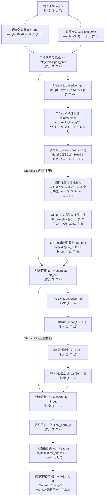

# GPT-2 Toy 全链路像素级深度剖析报告 (Complete Dissection Report)

> **自动生成说明**：本报告由 `run_gpt2toy.py` 运行 `gpt2toy.py` 并录制生成，随机种子为 `123`，处于推断模式 (`model.eval()`, `drop_rate=0.0`)。所有矩阵与中间张量数值均来自该运行的 PyTorch 前向传播。

**本次生成结果**：初始上下文 `"Hello, I am"` (`[2, 3, 4, 5]`) → 最终 Token IDs `[2, 3, 4, 5, 1, 5]`，文本 `"Hello, I am <|endoftext|> am"`。

## 目录 (Table of Contents)

1. [全局拓扑与张量维度演化图 (Architecture & Tensor Flow)](#1-全局拓扑与张量维度演化图)
2. [超参数规格与 308 个可学习参数精确拆解](#2-超参数规格与-308-个可学习参数精确拆解)
3. [全模块初始权重矩阵清单 (Initialized Weights)](#3-全模块初始权重矩阵清单)
4. [自回归 Step 1 全链路前向传播剖析 (`T=4`: `Hello, I am` → `<|endoftext|>`)](#4-自回归-step-1-全链路前向传播剖析)
5. [自回归 Step 2 全链路前向传播剖析 (`T=5`: `Hello, I am <|endoftext|>` → `am`)](#5-自回归-step-2-全链路前向传播剖析)
6. [跨步因果不变性验证 (KV Cache 核心原理) 与同词异位对比](#6-跨步因果不变性验证与同词异位对比)

---
## 1. 全局拓扑与张量维度演化图

---
## 2. 超参数规格与 308 个可学习参数精确拆解

### 2.1 模型超参数表与微型词表

| 超参数名称 | 取值 | 架构意义说明 |
| :--- | :---: | :--- |
| `vocab_size` (词表大小) | `6` | 词表 ID 与 Token：0: '<\|unk\|>', 1: '<\|endoftext\|>', 2: 'Hello', 3: ',', 4: 'I', 5: 'am' |
| `context_length` (最大上下文长度) | `5` | 位置嵌入表支持 `Pos = 0..4` |
| `emb_dim` (嵌入维度 $d_{\text{model}}$) | `4` | 主干残差流向量宽度为 4 维 |
| `n_heads` (注意力头数 $H$) | `2` | 每个头维度 $d_k = d_v = 4 / 2 = 2$ |
| `ffn_hidden_dim` (FFN 隐藏维) | `16` | 前馈网络映射维度为 4 → 16 → 4 |
| `n_layers` (Transformer 层数) | `1` | 包含 1 个 `TransformerBlock` |
| `qkv_bias` / `drop_rate` | `False` / `0.0` | Q/K/V bias=False；推断模式下 Dropout 关闭 |

### 2.2 全模块可学习参数量实测分布

| 所属阶段 | 模块 / 参数张量 | 权重形状 | 含 Bias | 参数量 |
| :--- | :--- | :---: | :---: | ---: |
| 1. 输入嵌入阶段 | `tok_emb.weight` | `(6, 4)` | `False` | `24` |
| 1. 输入嵌入阶段 | `pos_emb.weight` | `(5, 4)` | `False` | `20` |
| 2. TransformerBlock (每层) | `norm1` (`scale` + `shift`) | `(4,) + (4,)` | — | `8` |
| 2. TransformerBlock (每层) | `att.W_query / W_key / W_value` | `3 × (4, 4)` | `False` | `48` |
| 2. TransformerBlock (每层) | `att.out_proj` (`weight` + `bias`) | `(4, 4) + (4,)` | `True` | `20` |
| 2. TransformerBlock (每层) | `norm2` (`scale` + `shift`) | `(4,) + (4,)` | — | `8` |
| 2. TransformerBlock (每层) | `ff.layers[0]` (升维 `4→16`) | `(16, 4) + (16,)` | `True` | `80` |
| 2. TransformerBlock (每层) | `ff.layers[2]` (降维 `16→4`) | `(4, 16) + (4,)` | `True` | `68` |
| **所有 TransformerBlock (共 1 层)** | **每层参数总和** | — | — | **`232`** |
| 3. 输出预测阶段 | `final_norm` (`scale` + `shift`) | `(4,) + (4,)` | — | `8` |
| 3. 输出预测阶段 | `out_head.weight` (词表投影) | `(6, 4)` | `False` | `24` |
| **全模型总计 (Total)** | **所有可学习参数** | **Float32 占 1232 Bytes** | — | **`308`** |

---
## 3. 全模块初始权重矩阵清单 (Initialized Weights)

> **注意**：PyTorch 中 `nn.Linear(in_features, out_features)` 的 `.weight` 存储形状为 `(out_features, in_features)`，前向计算公式为 $y = x W^T + b$。

### 3.1 词嵌入表 `tok_emb.weight` `(6 × 4)` 与 位置嵌入表 `pos_emb.weight` `(5 × 4)`

**词嵌入查找表 `tok_emb.weight` (行号即 Token ID)：**

| Token ID (词元) | Dim 0 | Dim 1 | Dim 2 | Dim 3 |
| :--- | ---: | ---: | ---: | ---: |
| `ID=0` (`'<\|unk\|>'`) | 0.3374 | -0.1778 | -0.3035 | -0.5880 |
| `ID=1` (`'<\|endoftext\|>'`) | 0.3486 | 0.6603 | -0.2196 | -0.3792 |
| `ID=2` (`'Hello'`) | -0.1606 | -0.4015 | 0.6957 | -1.8061 |
| `ID=3` (`','`) | 1.8960 | -0.1750 | 1.3689 | -1.6033 |
| `ID=4` (`'I'`) | -0.7849 | -1.4096 | -0.4076 | 0.7953 |
| `ID=5` (`'am'`) | 0.9985 | 0.2212 | 1.8319 | -0.3378 |

**位置嵌入查找表 `pos_emb.weight` (行号即序列位置 `0..4`)：**

| 位置索引 Pos | Dim 0 | Dim 1 | Dim 2 | Dim 3 |
| :--- | ---: | ---: | ---: | ---: |
| `Pos=0` | 0.9624 | 0.2492 | -0.4845 | -2.0929 |
| `Pos=1` | 1.3111 | -0.2199 | 0.2190 | 0.2045 |
| `Pos=2` | 0.5146 | 0.9938 | -0.2587 | -1.0826 |
| `Pos=3` | 0.1036 | -2.1996 | -0.0885 | -0.5612 |
| `Pos=4` | 0.6716 | 0.6933 | -0.9487 | -0.0765 |

### 3.2 `TransformerBlock 0` 内部权重矩阵

- **`norm1` (Pre-LN 1)**: `scale` = `[1.0000, 1.0000, 1.0000, 1.0000]`, `shift` = `[0.0000, 0.0000, 0.0000, 0.0000]`

- **`norm2` (Pre-LN 2)**: `scale` = `[1.0000, 1.0000, 1.0000, 1.0000]`, `shift` = `[0.0000, 0.0000, 0.0000, 0.0000]`

**Query 投影矩阵 `att.W_query.weight` `(4 × 4)`**（每 2 行归属一个注意力头，共 2 个头）：

| 输出维度 (归属头) | InDim 0 | InDim 1 | InDim 2 | InDim 3 |
| :--- | ---: | ---: | ---: | ---: |
| `OutDim 0` (`Head 0, d0`) | 0.2050 | -0.4886 | -0.0298 | 0.3526 |
| `OutDim 1` (`Head 0, d1`) | 0.2320 | 0.0183 | 0.0983 | -0.0473 |
| `OutDim 2` (`Head 1, d0`) | -0.2749 | -0.1889 | -0.3045 | 0.4153 |
| `OutDim 3` (`Head 1, d1`) | 0.2751 | 0.1749 | -0.3834 | 0.3858 |

**Key 投影矩阵 `att.W_key.weight` `(4 × 4)`**（每 2 行归属一个注意力头，共 2 个头）：

| 输出维度 (归属头) | InDim 0 | InDim 1 | InDim 2 | InDim 3 |
| :--- | ---: | ---: | ---: | ---: |
| `OutDim 0` (`Head 0, d0`) | 0.1568 | 0.3459 | -0.1967 | 0.1060 |
| `OutDim 1` (`Head 0, d1`) | 0.4882 | 0.3363 | 0.4010 | -0.1050 |
| `OutDim 2` (`Head 1, d0`) | 0.3809 | -0.3916 | 0.0432 | -0.2815 |
| `OutDim 3` (`Head 1, d1`) | -0.1166 | -0.1280 | 0.0374 | 0.4551 |

**Value 投影矩阵 `att.W_value.weight` `(4 × 4)`**（每 2 行归属一个注意力头，共 2 个头）：

| 输出维度 (归属头) | InDim 0 | InDim 1 | InDim 2 | InDim 3 |
| :--- | ---: | ---: | ---: | ---: |
| `OutDim 0` (`Head 0, d0`) | 0.2475 | -0.0021 | 0.3549 | -0.2562 |
| `OutDim 1` (`Head 0, d1`) | 0.2577 | -0.0464 | -0.0870 | 0.0585 |
| `OutDim 2` (`Head 1, d0`) | -0.3830 | 0.0578 | 0.1681 | 0.4275 |
| `OutDim 3` (`Head 1, d1`) | -0.1557 | 0.1800 | 0.4998 | -0.2145 |

**多头输出投影层 `att.out_proj.weight` `(4 × 4)` 与 `bias` `(4,)`：**

| 输出维度 | InDim 0 (H0,d0) | InDim 1 (H0,d1) | InDim 2 (H1,d0) | InDim 3 (H1,d1) | Bias |
| :--- | ---: | ---: | ---: | ---: | ---: |
| `OutDim 0` | 0.4753 | -0.2482 | 0.2204 | 0.1959 | 0.0024 |
| `OutDim 1` | 0.1397 | 0.3954 | -0.2021 | 0.1314 | -0.1555 |
| `OutDim 2` | 0.0028 | -0.3761 | -0.1214 | -0.3339 | 0.1437 |
| `OutDim 3` | 0.2211 | 0.0449 | 0.0490 | -0.1517 | 0.4856 |

<b>点击展开查看 FFN 升维层 (16×4) 与 降维层 (4×16) 完整权重表</b>

**FFN 升维层 `ff.layers[0].weight` `(16 × 4)` 与 `bias` `(16,)`：**

| 隐藏维索引 | InDim 0 | InDim 1 | InDim 2 | InDim 3 | Bias |
| :--- | ---: | ---: | ---: | ---: | ---: |
| `HidDim 00` | 0.0757 | -0.2215 | -0.3054 | 0.0382 | -0.0730 |
| `HidDim 01` | -0.3709 | -0.3758 | -0.3254 | -0.1698 | 0.3210 |
| `HidDim 02` | 0.0370 | 0.3443 | 0.1937 | 0.3831 | -0.1395 |
| `HidDim 03` | -0.3139 | 0.0422 | -0.4444 | 0.2868 | -0.0484 |
| `HidDim 04` | 0.1042 | 0.4836 | -0.3556 | 0.4010 | 0.2056 |
| `HidDim 05` | 0.4221 | 0.4043 | 0.0713 | 0.4546 | -0.3147 |
| `HidDim 06` | 0.3339 | 0.3730 | -0.0325 | -0.3837 | 0.1339 |
| `HidDim 07` | -0.0062 | 0.0938 | -0.3406 | -0.2868 | -0.1106 |
| `HidDim 08` | -0.4794 | -0.1753 | 0.4355 | 0.0855 | 0.2398 |
| `HidDim 09` | -0.0305 | 0.0201 | 0.3118 | -0.4415 | -0.2712 |
| `HidDim 10` | -0.3858 | -0.1662 | -0.2878 | 0.2579 | 0.0185 |
| `HidDim 11` | 0.3533 | -0.4851 | -0.4243 | -0.4869 | 0.0489 |
| `HidDim 12` | 0.1886 | 0.4024 | -0.3877 | -0.2315 | -0.4023 |
| `HidDim 13` | 0.1591 | -0.3265 | 0.4247 | 0.1166 | -0.3636 |
| `HidDim 14` | -0.1392 | 0.0325 | 0.1559 | -0.1768 | 0.1918 |
| `HidDim 15` | -0.3874 | 0.0034 | 0.0091 | 0.0101 | -0.1455 |

**FFN 降维层 `ff.layers[2].weight` `(4 × 16)` 与 `bias` `(4,)`：**

| 输出维度 | InDim [0..7] | InDim [8..15] | Bias |
| :--- | :--- | :--- | ---: |
| `OutDim 0` | [0.1485, -0.2470, -0.1236, -0.2059, 0.0999, -0.0072, -0.0466, -0.0416] | [-0.1954, 0.0709, 0.0062, -0.1725, 0.0941, -0.0050, -0.2418, 0.1345] | -0.2013 |
| `OutDim 1` | [0.1337, -0.0471, -0.1726, 0.0100, 0.1886, 0.2288, -0.1887, -0.1129] | [0.1947, 0.1222, 0.1548, -0.1244, 0.2154, -0.2055, -0.0120, 0.0052] | -0.1022 |
| `OutDim 2` | [0.0420, -0.1886, 0.2294, 0.2457, -0.1727, 0.0092, -0.1332, 0.2397] | [0.1394, 0.1472, 0.0807, -0.0249, 0.1408, 0.0043, -0.0912, 0.1291] | 0.2013 |
| `OutDim 3` | [0.0785, -0.0648, -0.0685, -0.2211, -0.0685, -0.1013, -0.1363, -0.2258] | [0.1958, -0.2234, 0.2482, -0.1311, -0.0192, 0.2039, 0.0825, -0.0714] | -0.0944 |

### 3.3 最终归一化 `final_norm` 与 词表输出头 `out_head.weight` `(6 × 4)`

- **`final_norm`**: `scale` = `[1.0000, 1.0000, 1.0000, 1.0000]`, `shift` = `[0.0000, 0.0000, 0.0000, 0.0000]`

| 预测目标词表项 | InDim 0 | InDim 1 | InDim 2 | InDim 3 |
| :--- | ---: | ---: | ---: | ---: |
| `ID=0` (`'<\|unk\|>'`) | 0.4167 | -0.0861 | -0.0638 | 0.1996 |
| `ID=1` (`'<\|endoftext\|>'`) | -0.0735 | -0.0042 | 0.3463 | 0.1671 |
| `ID=2` (`'Hello'`) | -0.0199 | 0.1904 | 0.4355 | 0.1260 |
| `ID=3` (`','`) | -0.1466 | 0.1638 | -0.0437 | -0.3909 |
| `ID=4` (`'I'`) | -0.1931 | 0.2274 | 0.0164 | 0.1845 |
| `ID=5` (`'am'`) | -0.2927 | 0.4727 | -0.2087 | 0.1066 |

---
## 4. 自回归 Step 1 全链路前向传播剖析

- **当前步骤输入文本**: `"Hello, I am"`

- **输入 Token IDs (`in_idx`)**: `[2, 3, 4, 5]` (形状 `(B=1, T=4)`)

- **位置编号 (`pos_indices`)**: `[0, 1, 2, 3]`

### 4.1 阶段一：输入嵌入查表与广播相加 (`Input Embeddings`)

计算公式：
$$X_{t, d} = W_{\text{tok}}[\text{in\_idx}_t, d] + W_{\text{pos}}[t, d]$$

| 序列位置 Token | 词嵌入查表 `tok_emb[ID]` | 位置嵌入查表 `pos_emb[Pos]` | 融合结果 `x = tok + pos` |
| :--- | :--- | :--- | :--- |
| `t0[ID=2:'Hello']` | `tok_emb[2]` = `[-0.1606, -0.4015, 0.6957, -1.8061]` | `pos_emb[0]` = `[0.9624, 0.2492, -0.4845, -2.0929]` | `[0.8019, -0.1523, 0.2112, -3.8990]` |
| `t1[ID=3:',']` | `tok_emb[3]` = `[1.8960, -0.1750, 1.3689, -1.6033]` | `pos_emb[1]` = `[1.3111, -0.2199, 0.2190, 0.2045]` | `[3.2070, -0.3950, 1.5879, -1.3988]` |
| `t2[ID=4:'I']` | `tok_emb[4]` = `[-0.7849, -1.4096, -0.4076, 0.7953]` | `pos_emb[2]` = `[0.5146, 0.9938, -0.2587, -1.0826]` | `[-0.2702, -0.4158, -0.6664, -0.2872]` |
| `t3[ID=5:'am']` | `tok_emb[5]` = `[0.9985, 0.2212, 1.8319, -0.3378]` | `pos_emb[3]` = `[0.1036, -2.1996, -0.0885, -0.5612]` | `[1.1022, -1.9784, 1.7434, -0.8990]` |

### 4.2 阶段二：`Pre-LN 1 (norm1)` 内部统计量与归一化验算

对每个 Token 的 4 维向量独立求均值 $\mu_t = \frac{1}{4}\sum_{d=0}^{3} x_{t,d}$ 与有偏方差 $\sigma^2_t = \frac{1}{4}\sum_{d=0}^{3} (x_{t,d}-\mu_t)^2$，再执行标准化 $\hat{x}_{t,d} = \frac{x_{t,d} - \mu_t}{\sqrt{\sigma^2_t + 10^{-5}}}$：

| Token | 输入向量 `x` | 均值 `μ` | 有偏方差 `σ²` | 分母 `√(σ²+ε)` | 归一化输出 `x_norm1` | 后验校验 |
| :--- | :--- | ---: | ---: | ---: | :--- | :---: |
| `t0[ID=2:'Hello']` | `[0.8019, -0.1523, 0.2112, -3.8990]` | -0.7595 | 3.4013 | 1.8443 | `[0.8466, 0.3293, 0.5264, -1.7023]` | `μ'=0.0000, σ'²=1.0000` |
| `t1[ID=3:',']` | `[3.2070, -0.3950, 1.5879, -1.3988]` | 0.7503 | 3.1668 | 1.7795 | `[1.3805, -0.6436, 0.4707, -1.2076]` | `μ'=-0.0000, σ'²=1.0000` |
| `t2[ID=4:'I']` | `[-0.2702, -0.4158, -0.6664, -0.2872]` | -0.4099 | 0.0251 | 0.1584 | `[0.8816, -0.0373, -1.6187, 0.7743]` | `μ'=0.0000, σ'²=0.9996` |
| `t3[ID=5:'am']` | `[1.1022, -1.9784, 1.7434, -0.8990]` | -0.0080 | 2.2441 | 1.4980 | `[0.7411, -1.3154, 1.1691, -0.5948]` | `μ'=0.0000, σ'²=1.0000` |

### 4.3 阶段三：因果多头注意力 (`MultiHeadAttention`) 全链路显微镜

#### (4.3.1) 切头前完整 4 维线性映射 vs 2 个注意力头

线性变换 $Q = X_{\text{norm1}} W_Q^T,\; K = X_{\text{norm1}} W_K^T,\; V = X_{\text{norm1}} W_V^T$ 输出形状均为 `(1, T, 4)`。随后重排为 `(1, 2, T, 2)`，各头对应切片：Head 0 (列 0..1), Head 1 (列 2..3)。

| Token | `Q_full (4维)` | `Q_Head0` | `Q_Head1` | `K_Head0` | `K_Head1` | `V_Head0` | `V_Head1` |
| :--- | :--- | :--- | :--- | :--- | :--- | :--- | :--- |
| `t0[ID=2:'Hello']` | `[-0.6033, 0.3347, -1.1622, -0.5681]` | `[-0.6033, 0.3347]` | `[-1.1622, -0.5681]` | `[-0.0374, 0.9139]` | `[0.6956, -0.8958]` | `[0.8319, 0.0575]` | `[-0.9444, 0.5556]` |
| `t1[ID=3:',']` | `[0.1575, 0.4119, -0.9028, -0.3791]` | `[0.1575, 0.4119]` | `[-0.9028, -0.3791]` | `[-0.2268, 0.7730]` | `[1.1383, -0.6105]` | `[0.8196, 0.2739]` | `[-1.0031, 0.1635]` |
| `t2[ID=4:'I']` | `[0.5202, 0.0080, 0.5791, 1.1555]` | `[0.5202, 0.0080]` | `[0.5791, 1.1555]` | `[0.5258, -0.3125]` | `[0.0624, 0.1938]` | `[-0.5546, 0.4151]` | `[-0.2810, -1.1190]` |
| `t3[ID=5:'am']` | `[0.5499, 0.2910, -0.5582, -0.7039]` | `[0.5499, 0.2910]` | `[-0.5582, -0.7039]` | `[-0.6318, 0.4507]` | `[1.0154, -0.1449]` | `[0.7536, 0.1154]` | `[-0.4176, 0.3597]` |

#### (4.3.2) 注意力得分矩阵四步演化 (`Raw` → `Scaled` → `Masked` → `Softmax`)

缩放因子 $\sqrt{d_k} = \sqrt{2} \approx 1.4142$。因果掩码将上三角区域 ($j > i$，即未来位置) 置为 $-\infty$，使得 $\text{softmax}$ 后未来位置权重严格为 `0.0000`：

**【Head 0】四步注意力矩阵 (`4 × 4`)：**

- **① 原始点积得分 `raw_scores = Q_0 @ K_0^T`**：

| Query 位置 \ Key 位置 | `t0` (`'Hello'`) | `t1` (`','`) | `t2` (`'I'`) | `t3` (`'am'`) |
| :--- | ---: | ---: | ---: | ---: |
| `t0[ID=2:'Hello']` | 0.3284 | 0.3956 | -0.4218 | 0.5320 |
| `t1[ID=3:',']` | 0.3705 | 0.2827 | -0.0459 | 0.0861 |
| `t2[ID=4:'I']` | -0.0121 | -0.1118 | 0.2710 | -0.3251 |
| `t3[ID=5:'am']` | 0.2454 | 0.1002 | 0.1982 | -0.2163 |

- **② 缩放得分 `unmasked_scaled = raw_scores / √2`**：

| Query 位置 \ Key 位置 | `t0` (`'Hello'`) | `t1` (`','`) | `t2` (`'I'`) | `t3` (`'am'`) |
| :--- | ---: | ---: | ---: | ---: |
| `t0[ID=2:'Hello']` | 0.2322 | 0.2797 | -0.2983 | 0.3762 |
| `t1[ID=3:',']` | 0.2620 | 0.1999 | -0.0325 | 0.0609 |
| `t2[ID=4:'I']` | -0.0086 | -0.0790 | 0.1916 | -0.2298 |
| `t3[ID=5:'am']` | 0.1735 | 0.0709 | 0.1402 | -0.1530 |

- **③ 因果掩码遮蔽后得分 `masked_scores` ($j > i$ 置为 $-\infty$)**：

| Query 位置 \ Key 位置 | `t0` (`'Hello'`) | `t1` (`','`) | `t2` (`'I'`) | `t3` (`'am'`) |
| :--- | ---: | ---: | ---: | ---: |
| `t0[ID=2:'Hello']` | 0.2322 | -∞ | -∞ | -∞ |
| `t1[ID=3:',']` | 0.2620 | 0.1999 | -∞ | -∞ |
| `t2[ID=4:'I']` | -0.0086 | -0.0790 | 0.1916 | -∞ |
| `t3[ID=5:'am']` | 0.1735 | 0.0709 | 0.1402 | -0.1530 |

- **④ Softmax 注意力权重 `attn_weights`（推断模式关闭 Dropout，行和为 `1.0000`）**：

| Query 位置 \ Key 位置 | `t0` (`'Hello'`) | `t1` (`','`) | `t2` (`'I'`) | `t3` (`'am'`) |
| :--- | ---: | ---: | ---: | ---: |
| `t0[ID=2:'Hello']` | 1.0000 | 0.0000 | 0.0000 | 0.0000 |
| `t1[ID=3:',']` | 0.5155 | 0.4845 | 0.0000 | 0.0000 |
| `t2[ID=4:'I']` | 0.3171 | 0.2955 | 0.3874 | 0.0000 |
| `t3[ID=5:'am']` | 0.2785 | 0.2513 | 0.2693 | 0.2009 |

**【Head 1】四步注意力矩阵 (`4 × 4`)：**

- **① 原始点积得分 `raw_scores = Q_1 @ K_1^T`**：

| Query 位置 \ Key 位置 | `t0` (`'Hello'`) | `t1` (`','`) | `t2` (`'I'`) | `t3` (`'am'`) |
| :--- | ---: | ---: | ---: | ---: |
| `t0[ID=2:'Hello']` | -0.2995 | -0.9761 | -0.1827 | -1.0978 |
| `t1[ID=3:',']` | -0.2883 | -0.7962 | -0.1298 | -0.8618 |
| `t2[ID=4:'I']` | -0.6323 | -0.0462 | 0.2601 | 0.4206 |
| `t3[ID=5:'am']` | 0.2423 | -0.2057 | -0.1713 | -0.4648 |

- **② 缩放得分 `unmasked_scaled = raw_scores / √2`**：

| Query 位置 \ Key 位置 | `t0` (`'Hello'`) | `t1` (`','`) | `t2` (`'I'`) | `t3` (`'am'`) |
| :--- | ---: | ---: | ---: | ---: |
| `t0[ID=2:'Hello']` | -0.2118 | -0.6902 | -0.1292 | -0.7763 |
| `t1[ID=3:',']` | -0.2039 | -0.5630 | -0.0918 | -0.6094 |
| `t2[ID=4:'I']` | -0.4471 | -0.0327 | 0.1839 | 0.2974 |
| `t3[ID=5:'am']` | 0.1713 | -0.1454 | -0.1211 | -0.3287 |

- **③ 因果掩码遮蔽后得分 `masked_scores` ($j > i$ 置为 $-\infty$)**：

| Query 位置 \ Key 位置 | `t0` (`'Hello'`) | `t1` (`','`) | `t2` (`'I'`) | `t3` (`'am'`) |
| :--- | ---: | ---: | ---: | ---: |
| `t0[ID=2:'Hello']` | -0.2118 | -∞ | -∞ | -∞ |
| `t1[ID=3:',']` | -0.2039 | -0.5630 | -∞ | -∞ |
| `t2[ID=4:'I']` | -0.4471 | -0.0327 | 0.1839 | -∞ |
| `t3[ID=5:'am']` | 0.1713 | -0.1454 | -0.1211 | -0.3287 |

- **④ Softmax 注意力权重 `attn_weights`（推断模式关闭 Dropout，行和为 `1.0000`）**：

| Query 位置 \ Key 位置 | `t0` (`'Hello'`) | `t1` (`','`) | `t2` (`'I'`) | `t3` (`'am'`) |
| :--- | ---: | ---: | ---: | ---: |
| `t0[ID=2:'Hello']` | 1.0000 | 0.0000 | 0.0000 | 0.0000 |
| `t1[ID=3:',']` | 0.5888 | 0.4112 | 0.0000 | 0.0000 |
| `t2[ID=4:'I']` | 0.2276 | 0.3445 | 0.4278 | 0.0000 |
| `t3[ID=5:'am']` | 0.3245 | 0.2364 | 0.2422 | 0.1968 |

#### (4.3.3) Value 加权求和、多头左右拼接与 `out_proj` 输出线性投影

每个头独立计算 $\text{context}_h = \text{attn\_weights}_h V_h \in \mathbb{R}^{T \times 2}$，再将 2 个头拼接为 $\text{context}_{\text{merged}} \in \mathbb{R}^{T \times 4}$，最后经 `out_proj` 映射为 `att_out`：

| Token | `Head 0 Context (2维)` | `Head 1 Context (2维)` | 多头拼接 `Concat (4维)` | 投影输出 `att_out (4维)` |
| :--- | :--- | :--- | :--- | :--- |
| `t0[ID=2:'Hello']` | `[0.8319, 0.0575]` | `[-0.9444, 0.5556]` | `[0.8319, 0.0575, -0.9444, 0.5556]` | `[0.2842, 0.2473, 0.0535, 0.5415]` |
| `t1[ID=3:',']` | `[0.8259, 0.1623]` | `[-0.9686, 0.3944]` | `[0.8259, 0.1623, -0.9686, 0.3944]` | `[0.2184, 0.2716, 0.0708, 0.5682]` |
| `t2[ID=4:'I']` | `[0.2912, 0.2600]` | `[-0.6808, -0.2959]` | `[0.2912, 0.2600, -0.6808, -0.2959]` | `[-0.1318, 0.0866, 0.2282, 0.5732]` |
| `t3[ID=5:'am']` | `[0.4396, 0.2198]` | `[-0.6939, 0.0187]` | `[0.4396, 0.2198, -0.6939, 0.0187]` | `[0.0075, 0.1355, 0.1402, 0.5558]` |

### 4.4 阶段四：残差连接 1 (`Shortcut 1`: `x = shortcut1 + att_out`)

| Token | 主干输入 `shortcut1` | 子层增量 `att_out` | 残差融合输出 `x_res1` |
| :--- | :--- | :--- | :--- |
| `t0[ID=2:'Hello']` | `[0.8019, -0.1523, 0.2112, -3.8990]` | `[0.2842, 0.2473, 0.0535, 0.5415]` | `[1.0861, 0.0950, 0.2647, -3.3574]` |
| `t1[ID=3:',']` | `[3.2070, -0.3950, 1.5879, -1.3988]` | `[0.2184, 0.2716, 0.0708, 0.5682]` | `[3.4255, -0.1234, 1.6587, -0.8305]` |
| `t2[ID=4:'I']` | `[-0.2702, -0.4158, -0.6664, -0.2872]` | `[-0.1318, 0.0866, 0.2282, 0.5732]` | `[-0.4020, -0.3292, -0.4382, 0.2860]` |
| `t3[ID=5:'am']` | `[1.1022, -1.9784, 1.7434, -0.8990]` | `[0.0075, 0.1355, 0.1402, 0.5558]` | `[1.1097, -1.8429, 1.8836, -0.3432]` |

### 4.5 阶段五：`Pre-LN 2 (norm2)` → 前馈网络 (`FFN`) → 残差连接 2 (`Shortcut 2`)

**(1) `Pre-LN 2 (norm2)` 统计量与归一化输出：**

| Token | 均值 `μ` | 方差 `σ²` | 标准差 `std` | 归一化输出 `x_norm2` |
| :--- | ---: | ---: | ---: | :--- |
| `t0[ID=2:'Hello']` | -0.4779 | 2.9044 | 1.7042 | `[0.9177, 0.3362, 0.4358, -1.6896]` |
| `t1[ID=3:',']` | 1.0326 | 2.7314 | 1.6527 | `[1.4479, -0.6994, 0.3789, -1.1273]` |
| `t2[ID=4:'I']` | -0.2208 | 0.0872 | 0.2952 | `[-0.6135, -0.3670, -0.7361, 1.7166]` |
| `t3[ID=5:'am']` | 0.2018 | 2.0327 | 1.4257 | `[0.6368, -1.4342, 1.1796, -0.3823]` |

**(2) `FFN` 升维 (`4→16`)、GELU 激活与降维 (`16→4`) 输出：**

| Token | 升维 `fc1_out` (前4维预览) | 激活 `GELU(fc1)` (前4维预览) | 降维输出 `ff_out (4维)` |
| :--- | :--- | :--- | :--- |
| `t0[ID=2:'Hello']` | `[-0.2756, -0.0006, -0.5527, -1.0006] ...` (共16维) | `[-0.1079, -0.0003, -0.1604, -0.1588] ...` (共16维) | `[-0.3885, -0.4073, 0.0196, -0.4436]` |
| `t1[ID=3:',']` | `[0.0328, 0.1150, -0.6852, -1.0242] ...` (共16维) | `[0.0168, 0.0628, -0.1690, -0.1567] ...` (共16维) | `[-0.4392, -0.4657, -0.0212, -0.3228]` |
| `t2[ID=4:'I']` | `[0.2523, 0.6346, 0.2264, 0.9482] ...` (共16维) | `[0.1512, 0.4677, 0.1335, 0.7855] ...` (共16维) | `[-0.4085, 0.2480, 0.2816, -0.0241]` |
| `t3[ID=5:'am']` | `[-0.0820, 0.3048, -0.5277, -0.9428] ...` (共16维) | `[-0.0383, 0.1889, -0.1577, -0.1631] ...` (共16维) | `[-0.4599, -0.2383, 0.0933, 0.1051]` |

**(3) 残差连接 2 (`x_block_out = shortcut2 + ff_out`) 三列对照：**

| Token | 主干输入 `shortcut2 (x_res1)` | 子层增量 `ff_out` | Block 最终输出 `x_block_out` |
| :--- | :--- | :--- | :--- |
| `t0[ID=2:'Hello']` | `[1.0861, 0.0950, 0.2647, -3.3574]` | `[-0.3885, -0.4073, 0.0196, -0.4436]` | `[0.6976, -0.3123, 0.2843, -3.8010]` |
| `t1[ID=3:',']` | `[3.4255, -0.1234, 1.6587, -0.8305]` | `[-0.4392, -0.4657, -0.0212, -0.3228]` | `[2.9863, -0.5891, 1.6375, -1.1533]` |
| `t2[ID=4:'I']` | `[-0.4020, -0.3292, -0.4382, 0.2860]` | `[-0.4085, 0.2480, 0.2816, -0.0241]` | `[-0.8105, -0.0812, -0.1566, 0.2619]` |
| `t3[ID=5:'am']` | `[1.1097, -1.8429, 1.8836, -0.3432]` | `[-0.4599, -0.2383, 0.0933, 0.1051]` | `[0.6498, -2.0812, 1.9769, -0.2381]` |

### 4.6 阶段六：最终层归一化 (`final_norm`)、词表 Logits 投影与采样决策

| Token | 均值 `μ` | 方差 `σ²` | `final_norm` 输出 `(4维)` | 词表 Logits `out_head(x)` `(6维)` |
| :--- | ---: | ---: | :--- | :--- |
| `t0[ID=2:'Hello']` | -0.7829 | 3.1653 | `[0.8321, 0.2645, 0.5998, -1.6964]` | `[-0.0528, -0.1380, 0.0812, 0.5582, -0.4036, -0.4246]` |
| `t1[ID=3:',']` | 0.7203 | 2.8003 | `[1.3541, -0.7825, 0.5481, -1.1197]` | `[0.3733, -0.0935, -0.0784, 0.0870, -0.6369, -0.9999]` |
| `t2[ID=4:'I']` | -0.1966 | 0.1505 | `[-1.5824, 0.2974, 0.1031, 1.1818]` | `[-0.4557, 0.3482, 0.2820, -0.1858, 0.5928, 0.7082]` |
| `t3[ID=5:'am']` | 0.0769 | 2.1737 | `[0.3886, -1.4637, 1.2887, -0.2136]` | `[0.1632, 0.3882, 0.2478, -0.2697, -0.4262, -1.0973]` |

**末尾时间步 `t3[ID=5:'am']` 对 6 个候选词的预测概率分布与 Argmax 采样：**

| 候选 Token ID | 词元字符串 | 原始 Logit | Softmax 概率 | 采样决策 |
| :---: | :--- | ---: | ---: | :---: |
| `ID=0` | `'<\|unk\|>'` | 0.1632 | `20.71%` |  |
| `ID=1` | `'<\|endoftext\|>'` | 0.3882 | `25.94%` | **✅ 选中 (Argmax)** |
| `ID=2` | `'Hello'` | 0.2478 | `22.54%` |  |
| `ID=3` | `','` | -0.2697 | `13.44%` |  |
| `ID=4` | `'I'` | -0.4262 | `11.49%` |  |
| `ID=5` | `'am'` | -1.0973 | `5.87%` |  |

> **Step 1 结论**：贪婪采样选中 `ID=1` (`"<|endoftext|>"`), 序列更新为 `[2, 3, 4, 5, 1]` → 文本：`"Hello, I am <|endoftext|>"`。

---
## 5. 自回归 Step 2 全链路前向传播剖析

- **当前步骤输入文本**: `"Hello, I am <|endoftext|>"`

- **输入 Token IDs (`in_idx`)**: `[2, 3, 4, 5, 1]` (形状 `(B=1, T=5)`)

- **位置编号 (`pos_indices`)**: `[0, 1, 2, 3, 4]`

### 5.1 阶段一：输入嵌入查表与广播相加 (`Input Embeddings`)

计算公式：
$$X_{t, d} = W_{\text{tok}}[\text{in\_idx}_t, d] + W_{\text{pos}}[t, d]$$

| 序列位置 Token | 词嵌入查表 `tok_emb[ID]` | 位置嵌入查表 `pos_emb[Pos]` | 融合结果 `x = tok + pos` |
| :--- | :--- | :--- | :--- |
| `t0[ID=2:'Hello']` | `tok_emb[2]` = `[-0.1606, -0.4015, 0.6957, -1.8061]` | `pos_emb[0]` = `[0.9624, 0.2492, -0.4845, -2.0929]` | `[0.8019, -0.1523, 0.2112, -3.8990]` |
| `t1[ID=3:',']` | `tok_emb[3]` = `[1.8960, -0.1750, 1.3689, -1.6033]` | `pos_emb[1]` = `[1.3111, -0.2199, 0.2190, 0.2045]` | `[3.2070, -0.3950, 1.5879, -1.3988]` |
| `t2[ID=4:'I']` | `tok_emb[4]` = `[-0.7849, -1.4096, -0.4076, 0.7953]` | `pos_emb[2]` = `[0.5146, 0.9938, -0.2587, -1.0826]` | `[-0.2702, -0.4158, -0.6664, -0.2872]` |
| `t3[ID=5:'am']` | `tok_emb[5]` = `[0.9985, 0.2212, 1.8319, -0.3378]` | `pos_emb[3]` = `[0.1036, -2.1996, -0.0885, -0.5612]` | `[1.1022, -1.9784, 1.7434, -0.8990]` |
| `t4[ID=1:'<\|endoftext\|>']` | `tok_emb[1]` = `[0.3486, 0.6603, -0.2196, -0.3792]` | `pos_emb[4]` = `[0.6716, 0.6933, -0.9487, -0.0765]` | `[1.0202, 1.3536, -1.1684, -0.4557]` |

### 5.2 阶段二：`Pre-LN 1 (norm1)` 内部统计量与归一化验算

对每个 Token 的 4 维向量独立求均值 $\mu_t = \frac{1}{4}\sum_{d=0}^{3} x_{t,d}$ 与有偏方差 $\sigma^2_t = \frac{1}{4}\sum_{d=0}^{3} (x_{t,d}-\mu_t)^2$，再执行标准化 $\hat{x}_{t,d} = \frac{x_{t,d} - \mu_t}{\sqrt{\sigma^2_t + 10^{-5}}}$：

| Token | 输入向量 `x` | 均值 `μ` | 有偏方差 `σ²` | 分母 `√(σ²+ε)` | 归一化输出 `x_norm1` | 后验校验 |
| :--- | :--- | ---: | ---: | ---: | :--- | :---: |
| `t0[ID=2:'Hello']` | `[0.8019, -0.1523, 0.2112, -3.8990]` | -0.7595 | 3.4013 | 1.8443 | `[0.8466, 0.3293, 0.5264, -1.7023]` | `μ'=0.0000, σ'²=1.0000` |
| `t1[ID=3:',']` | `[3.2070, -0.3950, 1.5879, -1.3988]` | 0.7503 | 3.1668 | 1.7795 | `[1.3805, -0.6436, 0.4707, -1.2076]` | `μ'=-0.0000, σ'²=1.0000` |
| `t2[ID=4:'I']` | `[-0.2702, -0.4158, -0.6664, -0.2872]` | -0.4099 | 0.0251 | 0.1584 | `[0.8816, -0.0373, -1.6187, 0.7743]` | `μ'=0.0000, σ'²=0.9996` |
| `t3[ID=5:'am']` | `[1.1022, -1.9784, 1.7434, -0.8990]` | -0.0080 | 2.2441 | 1.4980 | `[0.7411, -1.3154, 1.1691, -0.5948]` | `μ'=0.0000, σ'²=1.0000` |
| `t4[ID=1:'<\|endoftext\|>']` | `[1.0202, 1.3536, -1.1684, -0.4557]` | 0.1874 | 1.0763 | 1.0375 | `[0.8027, 1.1241, -1.3068, -0.6199]` | `μ'=0.0000, σ'²=1.0000` |

### 5.3 阶段三：因果多头注意力 (`MultiHeadAttention`) 全链路显微镜

#### (5.3.1) 切头前完整 4 维线性映射 vs 2 个注意力头

线性变换 $Q = X_{\text{norm1}} W_Q^T,\; K = X_{\text{norm1}} W_K^T,\; V = X_{\text{norm1}} W_V^T$ 输出形状均为 `(1, T, 4)`。随后重排为 `(1, 2, T, 2)`，各头对应切片：Head 0 (列 0..1), Head 1 (列 2..3)。

| Token | `Q_full (4维)` | `Q_Head0` | `Q_Head1` | `K_Head0` | `K_Head1` | `V_Head0` | `V_Head1` |
| :--- | :--- | :--- | :--- | :--- | :--- | :--- | :--- |
| `t0[ID=2:'Hello']` | `[-0.6033, 0.3347, -1.1622, -0.5681]` | `[-0.6033, 0.3347]` | `[-1.1622, -0.5681]` | `[-0.0374, 0.9139]` | `[0.6956, -0.8958]` | `[0.8319, 0.0575]` | `[-0.9444, 0.5556]` |
| `t1[ID=3:',']` | `[0.1575, 0.4119, -0.9028, -0.3791]` | `[0.1575, 0.4119]` | `[-0.9028, -0.3791]` | `[-0.2268, 0.7730]` | `[1.1383, -0.6105]` | `[0.8196, 0.2739]` | `[-1.0031, 0.1635]` |
| `t2[ID=4:'I']` | `[0.5202, 0.0080, 0.5791, 1.1555]` | `[0.5202, 0.0080]` | `[0.5791, 1.1555]` | `[0.5258, -0.3125]` | `[0.0624, 0.1938]` | `[-0.5546, 0.4151]` | `[-0.2810, -1.1190]` |
| `t3[ID=5:'am']` | `[0.5499, 0.2910, -0.5582, -0.7039]` | `[0.5499, 0.2910]` | `[-0.5582, -0.7039]` | `[-0.6318, 0.4507]` | `[1.0154, -0.1449]` | `[0.7536, 0.1154]` | `[-0.4176, 0.3597]` |
| `t4[ID=1:'<\|endoftext\|>']` | `[-0.5643, 0.1076, -0.2926, 0.6793]` | `[-0.5643, 0.1076]` | `[-0.2926, 0.6793]` | `[0.7060, 0.3110]` | `[-0.0164, -0.5685]` | `[-0.1087, 0.2321]` | `[-0.7272, -0.4427]` |

#### (5.3.2) 注意力得分矩阵四步演化 (`Raw` → `Scaled` → `Masked` → `Softmax`)

缩放因子 $\sqrt{d_k} = \sqrt{2} \approx 1.4142$。因果掩码将上三角区域 ($j > i$，即未来位置) 置为 $-\infty$，使得 $\text{softmax}$ 后未来位置权重严格为 `0.0000`：

**【Head 0】四步注意力矩阵 (`5 × 5`)：**

- **① 原始点积得分 `raw_scores = Q_0 @ K_0^T`**：

| Query 位置 \ Key 位置 | `t0` (`'Hello'`) | `t1` (`','`) | `t2` (`'I'`) | `t3` (`'am'`) | `t4` (`'<\|endoftext\|>'`) |
| :--- | ---: | ---: | ---: | ---: | ---: |
| `t0[ID=2:'Hello']` | 0.3284 | 0.3956 | -0.4218 | 0.5320 | -0.3218 |
| `t1[ID=3:',']` | 0.3705 | 0.2827 | -0.0459 | 0.0861 | 0.2393 |
| `t2[ID=4:'I']` | -0.0121 | -0.1118 | 0.2710 | -0.3251 | 0.3698 |
| `t3[ID=5:'am']` | 0.2454 | 0.1002 | 0.1982 | -0.2163 | 0.4787 |
| `t4[ID=1:'<\|endoftext\|>']` | 0.1194 | 0.2111 | -0.3303 | 0.4050 | -0.3650 |

- **② 缩放得分 `unmasked_scaled = raw_scores / √2`**：

| Query 位置 \ Key 位置 | `t0` (`'Hello'`) | `t1` (`','`) | `t2` (`'I'`) | `t3` (`'am'`) | `t4` (`'<\|endoftext\|>'`) |
| :--- | ---: | ---: | ---: | ---: | ---: |
| `t0[ID=2:'Hello']` | 0.2322 | 0.2797 | -0.2983 | 0.3762 | -0.2276 |
| `t1[ID=3:',']` | 0.2620 | 0.1999 | -0.0325 | 0.0609 | 0.1692 |
| `t2[ID=4:'I']` | -0.0086 | -0.0790 | 0.1916 | -0.2298 | 0.2615 |
| `t3[ID=5:'am']` | 0.1735 | 0.0709 | 0.1402 | -0.1530 | 0.3385 |
| `t4[ID=1:'<\|endoftext\|>']` | 0.0844 | 0.1493 | -0.2336 | 0.2864 | -0.2581 |

- **③ 因果掩码遮蔽后得分 `masked_scores` ($j > i$ 置为 $-\infty$)**：

| Query 位置 \ Key 位置 | `t0` (`'Hello'`) | `t1` (`','`) | `t2` (`'I'`) | `t3` (`'am'`) | `t4` (`'<\|endoftext\|>'`) |
| :--- | ---: | ---: | ---: | ---: | ---: |
| `t0[ID=2:'Hello']` | 0.2322 | -∞ | -∞ | -∞ | -∞ |
| `t1[ID=3:',']` | 0.2620 | 0.1999 | -∞ | -∞ | -∞ |
| `t2[ID=4:'I']` | -0.0086 | -0.0790 | 0.1916 | -∞ | -∞ |
| `t3[ID=5:'am']` | 0.1735 | 0.0709 | 0.1402 | -0.1530 | -∞ |
| `t4[ID=1:'<\|endoftext\|>']` | 0.0844 | 0.1493 | -0.2336 | 0.2864 | -0.2581 |

- **④ Softmax 注意力权重 `attn_weights`（推断模式关闭 Dropout，行和为 `1.0000`）**：

| Query 位置 \ Key 位置 | `t0` (`'Hello'`) | `t1` (`','`) | `t2` (`'I'`) | `t3` (`'am'`) | `t4` (`'<\|endoftext\|>'`) |
| :--- | ---: | ---: | ---: | ---: | ---: |
| `t0[ID=2:'Hello']` | 1.0000 | 0.0000 | 0.0000 | 0.0000 | 0.0000 |
| `t1[ID=3:',']` | 0.5155 | 0.4845 | 0.0000 | 0.0000 | 0.0000 |
| `t2[ID=4:'I']` | 0.3171 | 0.2955 | 0.3874 | 0.0000 | 0.0000 |
| `t3[ID=5:'am']` | 0.2785 | 0.2513 | 0.2693 | 0.2009 | 0.0000 |
| `t4[ID=1:'<\|endoftext\|>']` | 0.2115 | 0.2257 | 0.1539 | 0.2588 | 0.1502 |

**【Head 1】四步注意力矩阵 (`5 × 5`)：**

- **① 原始点积得分 `raw_scores = Q_1 @ K_1^T`**：

| Query 位置 \ Key 位置 | `t0` (`'Hello'`) | `t1` (`','`) | `t2` (`'I'`) | `t3` (`'am'`) | `t4` (`'<\|endoftext\|>'`) |
| :--- | ---: | ---: | ---: | ---: | ---: |
| `t0[ID=2:'Hello']` | -0.2995 | -0.9761 | -0.1827 | -1.0978 | 0.3421 |
| `t1[ID=3:',']` | -0.2883 | -0.7962 | -0.1298 | -0.8618 | 0.2304 |
| `t2[ID=4:'I']` | -0.6323 | -0.0462 | 0.2601 | 0.4206 | -0.6664 |
| `t3[ID=5:'am']` | 0.2423 | -0.2057 | -0.1713 | -0.4648 | 0.4093 |
| `t4[ID=1:'<\|endoftext\|>']` | -0.8121 | -0.7478 | 0.1134 | -0.3956 | -0.3814 |

- **② 缩放得分 `unmasked_scaled = raw_scores / √2`**：

| Query 位置 \ Key 位置 | `t0` (`'Hello'`) | `t1` (`','`) | `t2` (`'I'`) | `t3` (`'am'`) | `t4` (`'<\|endoftext\|>'`) |
| :--- | ---: | ---: | ---: | ---: | ---: |
| `t0[ID=2:'Hello']` | -0.2118 | -0.6902 | -0.1292 | -0.7763 | 0.2419 |
| `t1[ID=3:',']` | -0.2039 | -0.5630 | -0.0918 | -0.6094 | 0.1629 |
| `t2[ID=4:'I']` | -0.4471 | -0.0327 | 0.1839 | 0.2974 | -0.4712 |
| `t3[ID=5:'am']` | 0.1713 | -0.1454 | -0.1211 | -0.3287 | 0.2894 |
| `t4[ID=1:'<\|endoftext\|>']` | -0.5742 | -0.5288 | 0.0802 | -0.2797 | -0.2697 |

- **③ 因果掩码遮蔽后得分 `masked_scores` ($j > i$ 置为 $-\infty$)**：

| Query 位置 \ Key 位置 | `t0` (`'Hello'`) | `t1` (`','`) | `t2` (`'I'`) | `t3` (`'am'`) | `t4` (`'<\|endoftext\|>'`) |
| :--- | ---: | ---: | ---: | ---: | ---: |
| `t0[ID=2:'Hello']` | -0.2118 | -∞ | -∞ | -∞ | -∞ |
| `t1[ID=3:',']` | -0.2039 | -0.5630 | -∞ | -∞ | -∞ |
| `t2[ID=4:'I']` | -0.4471 | -0.0327 | 0.1839 | -∞ | -∞ |
| `t3[ID=5:'am']` | 0.1713 | -0.1454 | -0.1211 | -0.3287 | -∞ |
| `t4[ID=1:'<\|endoftext\|>']` | -0.5742 | -0.5288 | 0.0802 | -0.2797 | -0.2697 |

- **④ Softmax 注意力权重 `attn_weights`（推断模式关闭 Dropout，行和为 `1.0000`）**：

| Query 位置 \ Key 位置 | `t0` (`'Hello'`) | `t1` (`','`) | `t2` (`'I'`) | `t3` (`'am'`) | `t4` (`'<\|endoftext\|>'`) |
| :--- | ---: | ---: | ---: | ---: | ---: |
| `t0[ID=2:'Hello']` | 1.0000 | 0.0000 | 0.0000 | 0.0000 | 0.0000 |
| `t1[ID=3:',']` | 0.5888 | 0.4112 | 0.0000 | 0.0000 | 0.0000 |
| `t2[ID=4:'I']` | 0.2276 | 0.3445 | 0.4278 | 0.0000 | 0.0000 |
| `t3[ID=5:'am']` | 0.3245 | 0.2364 | 0.2422 | 0.1968 | 0.0000 |
| `t4[ID=1:'<\|endoftext\|>']` | 0.1499 | 0.1569 | 0.2885 | 0.2013 | 0.2033 |

#### (5.3.3) Value 加权求和、多头左右拼接与 `out_proj` 输出线性投影

每个头独立计算 $\text{context}_h = \text{attn\_weights}_h V_h \in \mathbb{R}^{T \times 2}$，再将 2 个头拼接为 $\text{context}_{\text{merged}} \in \mathbb{R}^{T \times 4}$，最后经 `out_proj` 映射为 `att_out`：

| Token | `Head 0 Context (2维)` | `Head 1 Context (2维)` | 多头拼接 `Concat (4维)` | 投影输出 `att_out (4维)` |
| :--- | :--- | :--- | :--- | :--- |
| `t0[ID=2:'Hello']` | `[0.8319, 0.0575]` | `[-0.9444, 0.5556]` | `[0.8319, 0.0575, -0.9444, 0.5556]` | `[0.2842, 0.2473, 0.0535, 0.5415]` |
| `t1[ID=3:',']` | `[0.8259, 0.1623]` | `[-0.9686, 0.3944]` | `[0.8259, 0.1623, -0.9686, 0.3944]` | `[0.2184, 0.2716, 0.0708, 0.5682]` |
| `t2[ID=4:'I']` | `[0.2912, 0.2600]` | `[-0.6808, -0.2959]` | `[0.2912, 0.2600, -0.6808, -0.2959]` | `[-0.1318, 0.0866, 0.2282, 0.5732]` |
| `t3[ID=5:'am']` | `[0.4396, 0.2198]` | `[-0.6939, 0.0187]` | `[0.4396, 0.2198, -0.6939, 0.0187]` | `[0.0075, 0.1355, 0.1402, 0.5558]` |
| `t4[ID=1:'<\|endoftext\|>']` | `[0.4543, 0.2026]` | `[-0.6120, -0.2315]` | `[0.4543, 0.2026, -0.6120, -0.2315]` | `[-0.0122, 0.0813, 0.2204, 0.6002]` |

### 5.4 阶段四：残差连接 1 (`Shortcut 1`: `x = shortcut1 + att_out`)

| Token | 主干输入 `shortcut1` | 子层增量 `att_out` | 残差融合输出 `x_res1` |
| :--- | :--- | :--- | :--- |
| `t0[ID=2:'Hello']` | `[0.8019, -0.1523, 0.2112, -3.8990]` | `[0.2842, 0.2473, 0.0535, 0.5415]` | `[1.0861, 0.0950, 0.2647, -3.3574]` |
| `t1[ID=3:',']` | `[3.2070, -0.3950, 1.5879, -1.3988]` | `[0.2184, 0.2716, 0.0708, 0.5682]` | `[3.4255, -0.1234, 1.6587, -0.8305]` |
| `t2[ID=4:'I']` | `[-0.2702, -0.4158, -0.6664, -0.2872]` | `[-0.1318, 0.0866, 0.2282, 0.5732]` | `[-0.4020, -0.3292, -0.4382, 0.2860]` |
| `t3[ID=5:'am']` | `[1.1022, -1.9784, 1.7434, -0.8990]` | `[0.0075, 0.1355, 0.1402, 0.5558]` | `[1.1097, -1.8429, 1.8836, -0.3432]` |
| `t4[ID=1:'<\|endoftext\|>']` | `[1.0202, 1.3536, -1.1684, -0.4557]` | `[-0.0122, 0.0813, 0.2204, 0.6002]` | `[1.0080, 1.4349, -0.9480, 0.1446]` |

### 5.5 阶段五：`Pre-LN 2 (norm2)` → 前馈网络 (`FFN`) → 残差连接 2 (`Shortcut 2`)

**(1) `Pre-LN 2 (norm2)` 统计量与归一化输出：**

| Token | 均值 `μ` | 方差 `σ²` | 标准差 `std` | 归一化输出 `x_norm2` |
| :--- | ---: | ---: | ---: | :--- |
| `t0[ID=2:'Hello']` | -0.4779 | 2.9044 | 1.7042 | `[0.9177, 0.3362, 0.4358, -1.6896]` |
| `t1[ID=3:',']` | 1.0326 | 2.7314 | 1.6527 | `[1.4479, -0.6994, 0.3789, -1.1273]` |
| `t2[ID=4:'I']` | -0.2208 | 0.0872 | 0.2952 | `[-0.6135, -0.3670, -0.7361, 1.7166]` |
| `t3[ID=5:'am']` | 0.2018 | 2.0327 | 1.4257 | `[0.6368, -1.4342, 1.1796, -0.3823]` |
| `t4[ID=1:'<\|endoftext\|>']` | 0.4099 | 0.8307 | 0.9114 | `[0.6562, 1.1247, -1.4899, -0.2911]` |

**(2) `FFN` 升维 (`4→16`)、GELU 激活与降维 (`16→4`) 输出：**

| Token | 升维 `fc1_out` (前4维预览) | 激活 `GELU(fc1)` (前4维预览) | 降维输出 `ff_out (4维)` |
| :--- | :--- | :--- | :--- |
| `t0[ID=2:'Hello']` | `[-0.2756, -0.0006, -0.5527, -1.0006] ...` (共16维) | `[-0.1079, -0.0003, -0.1604, -0.1588] ...` (共16维) | `[-0.3885, -0.4073, 0.0196, -0.4436]` |
| `t1[ID=3:',']` | `[0.0328, 0.1150, -0.6852, -1.0242] ...` (共16维) | `[0.0168, 0.0628, -0.1690, -0.1567] ...` (共16维) | `[-0.4392, -0.4657, -0.0212, -0.3228]` |
| `t2[ID=4:'I']` | `[0.2523, 0.6346, 0.2264, 0.9482] ...` (共16维) | `[0.1512, 0.4677, 0.1335, 0.7855] ...` (共16维) | `[-0.4085, 0.2480, 0.2816, -0.0241]` |
| `t3[ID=5:'am']` | `[-0.0820, 0.3048, -0.5277, -0.9428] ...` (共16维) | `[-0.0383, 0.1889, -0.1577, -0.1631] ...` (共16维) | `[-0.4599, -0.2383, 0.0933, 0.1051]` |
| `t4[ID=1:'<\|endoftext\|>']` | `[0.1716, 0.1892, -0.1280, 0.3717] ...` (共16维) | `[0.0975, 0.1088, -0.0575, 0.2397] ...` (共16维) | `[-0.1935, 0.0205, 0.0566, -0.5071]` |

**(3) 残差连接 2 (`x_block_out = shortcut2 + ff_out`) 三列对照：**

| Token | 主干输入 `shortcut2 (x_res1)` | 子层增量 `ff_out` | Block 最终输出 `x_block_out` |
| :--- | :--- | :--- | :--- |
| `t0[ID=2:'Hello']` | `[1.0861, 0.0950, 0.2647, -3.3574]` | `[-0.3885, -0.4073, 0.0196, -0.4436]` | `[0.6976, -0.3123, 0.2843, -3.8010]` |
| `t1[ID=3:',']` | `[3.4255, -0.1234, 1.6587, -0.8305]` | `[-0.4392, -0.4657, -0.0212, -0.3228]` | `[2.9863, -0.5891, 1.6375, -1.1533]` |
| `t2[ID=4:'I']` | `[-0.4020, -0.3292, -0.4382, 0.2860]` | `[-0.4085, 0.2480, 0.2816, -0.0241]` | `[-0.8105, -0.0812, -0.1566, 0.2619]` |
| `t3[ID=5:'am']` | `[1.1097, -1.8429, 1.8836, -0.3432]` | `[-0.4599, -0.2383, 0.0933, 0.1051]` | `[0.6498, -2.0812, 1.9769, -0.2381]` |
| `t4[ID=1:'<\|endoftext\|>']` | `[1.0080, 1.4349, -0.9480, 0.1446]` | `[-0.1935, 0.0205, 0.0566, -0.5071]` | `[0.8145, 1.4555, -0.8914, -0.3625]` |

### 5.6 阶段六：最终层归一化 (`final_norm`)、词表 Logits 投影与采样决策

| Token | 均值 `μ` | 方差 `σ²` | `final_norm` 输出 `(4维)` | 词表 Logits `out_head(x)` `(6维)` |
| :--- | ---: | ---: | :--- | :--- |
| `t0[ID=2:'Hello']` | -0.7829 | 3.1653 | `[0.8321, 0.2645, 0.5998, -1.6964]` | `[-0.0528, -0.1380, 0.0812, 0.5582, -0.4036, -0.4246]` |
| `t1[ID=3:',']` | 0.7203 | 2.8003 | `[1.3541, -0.7825, 0.5481, -1.1197]` | `[0.3733, -0.0935, -0.0784, 0.0870, -0.6369, -0.9999]` |
| `t2[ID=4:'I']` | -0.1966 | 0.1505 | `[-1.5824, 0.2974, 0.1031, 1.1818]` | `[-0.4557, 0.3482, 0.2820, -0.1858, 0.5928, 0.7082]` |
| `t3[ID=5:'am']` | 0.0769 | 2.1737 | `[0.3886, -1.4637, 1.2887, -0.2136]` | `[0.1632, 0.3882, 0.2478, -0.2697, -0.4262, -1.0973]` |
| `t4[ID=1:'<\|endoftext\|>']` | 0.2540 | 0.8624 | `[0.6035, 1.2937, -1.2334, -0.6639]` | `[0.0863, -0.5878, -0.3864, 0.4369, 0.0350, 0.6214]` |

**末尾时间步 `t4[ID=1:'<|endoftext|>']` 对 6 个候选词的预测概率分布与 Argmax 采样：**

| 候选 Token ID | 词元字符串 | 原始 Logit | Softmax 概率 | 采样决策 |
| :---: | :--- | ---: | ---: | :---: |
| `ID=0` | `'<\|unk\|>'` | 0.0863 | `16.10%` |  |
| `ID=1` | `'<\|endoftext\|>'` | -0.5878 | `8.21%` |  |
| `ID=2` | `'Hello'` | -0.3864 | `10.04%` |  |
| `ID=3` | `','` | 0.4369 | `22.86%` |  |
| `ID=4` | `'I'` | 0.0350 | `15.30%` |  |
| `ID=5` | `'am'` | 0.6214 | `27.50%` | **✅ 选中 (Argmax)** |

> **Step 2 结论**：贪婪采样选中 `ID=5` (`"am"`), 序列更新为 `[2, 3, 4, 5, 1, 5]` → 文本：`"Hello, I am <|endoftext|> am"`。

---
## 6. 跨步因果不变性验证与同词异位对比

### 6.1 跨步因果不变性检查（已验证）

比较 Step 1 (T=4) 与 Step 2 (T=5) 的前 4 个相同前缀位置；按 tolerance `1e-06` 判断数值差异。

| 前向传播中间张量阶段 | 最大绝对误差 | 检查结果 |
| :--- | ---: | :---: |
| 输入嵌入 x = tok_emb + pos_emb | `0.00000000` | 通过 tolerance 检查 ✅ |
| Block 0 Pre-LN 1 输出 | `0.00000000` | 通过 tolerance 检查 ✅ |
| Block 0 MHA Queries | `0.00000000` | 通过 tolerance 检查 ✅ |
| Block 0 MHA Keys | `0.00000000` | 通过 tolerance 检查 ✅ |
| Block 0 MHA Values | `0.00000000` | 通过 tolerance 检查 ✅ |
| Block 0 Head 0 注意力权重前 4×4 子矩阵 | `0.00000000` | 通过 tolerance 检查 ✅ |
| Block 0 Head 1 注意力权重前 4×4 子矩阵 | `0.00000000` | 通过 tolerance 检查 ✅ |
| Block 0 MHA 多头拼接 | `0.00000000` | 通过 tolerance 检查 ✅ |
| Block 0 MHA 输出投影 | `0.00000000` | 通过 tolerance 检查 ✅ |
| Block 0 残差连接 1 | `0.00000000` | 通过 tolerance 检查 ✅ |
| Block 0 Pre-LN 2 | `0.00000000` | 通过 tolerance 检查 ✅ |
| Block 0 残差连接 2 | `0.00000000` | 通过 tolerance 检查 ✅ |
| Block 0 FFN 降维输出 | `0.00000000` | 通过 tolerance 检查 ✅ |
| Final LayerNorm 输出 | `0.00000000` | 通过 tolerance 检查 ✅ |
| 词表预测 Logits 前 4 个位置 | `0.00000000` | 通过 tolerance 检查 ✅ |

> **KV Cache 原理**：两次前向传播使用相同前缀和相同位置索引、并在推断模式关闭 Dropout 时，因果遮罩让每个位置只依赖可见前缀（含当前位置）；本次已将 K/V 和其他列出的张量按 tolerance `1e-06` 比较。KV Cache 可在这些条件下复用历史 K/V。不同硬件或计算路径可能产生微小浮点差异，不保证逐位完全相同。

### 6.2 同一 Token 出现在不同位置的独立前向传播

比较输入来自固定、独立的示例 `Hello, I am I`（IDs `[2, 3, 4, 5, 4]`），不是上方自回归步骤之一。Token `I` (ID=4) 位于 Pos=2 和 Pos=4。

| 比较阶段 | Pos 2 / token `I` | Pos 4 / token `I` | 实测解读 |
| :--- | :--- | :--- | :--- |
| 词嵌入查表 | `[-0.7849, -1.4096, -0.4076, 0.7953]` | `[-0.7849, -1.4096, -0.4076, 0.7953]` | 词嵌入相同（token_embeddings_equal=True） |
| 位置嵌入 | `[0.5146, 0.9938, -0.2587, -1.0826]` (Pos=2) | `[0.6716, 0.6933, -0.9487, -0.0765]` (Pos=4) | 位置嵌入不同（position_embeddings_equal=False） |
| 融合输入 `x_emb` | `[-0.2702, -0.4158, -0.6664, -0.2872]` | `[-0.1133, -0.7163, -1.3564, 0.7188]` | 词嵌入与位置嵌入相加 |
| Head 0 注意力权重（示例） | `[0.3171, 0.2955, 0.3874, 0.0000, 0.0000]` | `[0.1788, 0.1620, 0.2774, 0.1314, 0.2504]` | 每个位置的因果可见前缀长度不同 |
| Block 输出 `res2.out` | `[-0.8105, -0.0812, -0.1566, 0.2619]` | `[-0.6282, -0.4864, -0.9828, 1.1362]` | 首个 TransformerBlock 的实测输出 |
| Logits `(6 维)` | `[-0.4557, 0.3482, 0.2820, -0.1858, 0.5928, 0.7082]` | `[0.2228, 0.0030, -0.2319, -0.6000, 0.3198, 0.3667]` | Logits 不同（logits_equal=False）；argmax: ID=5 ('am') vs ID=5 ('am')；logits_equal=false，两个位置的 Logits 不同；argmax 是否相同以列出的实际 Token 为准。 |
