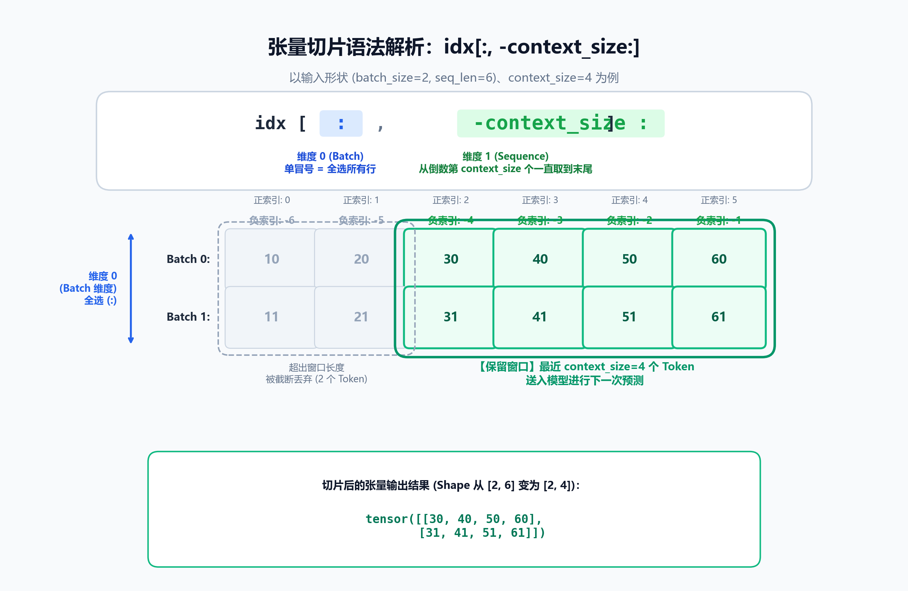

# 张量切片详解：idx[:, -context_size:]

在大语言模型（LLM / GPT-2）的文本生成过程中，经常会见到如下切片操作：

```python
idx_cond = idx[:, -context_size:]
```

这行代码的核心作用是：**只截取最近的 `context_size` 个 Token，确保送入模型的序列长度不会超出模型支持的最大上下文限制。**

---

## 1. 为什么有两个中括号？（维度概念）

在代码中如果看到：
```python
idx = [[10, 20, 30, 40, 50, 60]]
```
它拥有两层中括号，代表这是一个 **二维结构（形状为 `(1, 6)`）**：

* **外层中括号 `[` ... `]`**：代表 **Batch（批次）维度**（第 0 维）。即使当前只有 1 句话，批次维度也不能省略（此时 `batch_size = 1`）。
* **内层中括号 `[` ... `]`**：代表 **Sequence（序列）维度**（第 1 维）。里面是这句话中具体的各个 Token ID。

| 形式 | 形状 (Shape) | 含义 |
| :--- | :--- | :--- |
| `[10, 20, 30]` | `(3,)` | 一维列表/向量，缺少批次信息，输入模型会报维度错误 |
| `[[10, 20, 30]]` | `(1, 3)` | 二维张量（1 个批次，每批包含 3 个 Token） |
| `[[10, 20], [30, 40]]` | `(2, 2)` | 二维张量（2 个批次，每批包含 2 个 Token） |

---

## 2. 语法拆解：idx[:, -context_size:]

该语法是 PyTorch 张量（或 NumPy 数组）的**多维切片（Multi-dimensional Slicing）**：

$$\Large \text{idx}[\underbrace{\quad : \quad}_{\text{维度 0：Batch 维度}}, \quad \underbrace{-context\_size :}_{\text{维度 1：Sequence 维度}}]$$

### (1) 逗号 `,`：切分不同维度
* 逗号左侧控制**第 0 维（行 / Batch）**。
* 逗号右侧控制**第 1 维（列 / Sequence）**。

### (2) 逗号左侧的 `:`（单独一个冒号）
切片默认模板为 `[start:stop:step]`。当 `start` 和 `stop` 都省略时，单独一个冒号 `:` 表示**全选该维度所有元素**。
* 作用：保留所有样本批次（Batch 0, Batch 1 ... 都保留）。

### (3) 逗号右侧的 `-context_size:`
* `-context_size`：Python 负数索引，表示**从倒数第 `context_size` 个位置开始**。
* 冒号后省略结束位置：表示**一直截取到最后一个元素**。
* 作用：只提取每个样本最新的 `context_size` 个 Token。

---

## 3. 图解原理



以 `batch_size = 2`、当前序列长度为 6、模型最大上下文窗口 `context_size = 4` 为例：

1. **左侧超出部分**（索引 0、1）：超出模型能够处理的窗口长度，被截断丢弃。
2. **右侧高亮部分**（负索引 -4、-3、-2、-1）：保留的最新的 4 个 Token。
3. **输出形状**：张量从 `(2, 6)` 被裁剪为 `(2, 4)`，然后传入模型前向传播。

---

## 4. 在 LLM 文本生成中的实际应用

在自回归生成函数（如 `generate_text_simple`）中，模型不断循环预测下一个 Token 并拼接回 `idx` 中：

```python
def generate_text_simple(model, idx, max_new_tokens, context_size):
    for _ in range(max_new_tokens):
        # 1. 裁剪输入：只保留最新的 context_size 个 Token
        #    防止因序列超出模型的位置编码上限而报错
        idx_cond = idx[:, -context_size:]
        
        # 2. 前向传播预测
        with torch.no_grad():
            logits = model(idx_cond)
            
        # 3. 取最后一个时间步的预测结果
        logits = logits[:, -1, :]
        idx_next = torch.argmax(logits, dim=-1, keepdim=True)
        
        # 4. 拼接到当前序列末尾 (使得序列长度 + 1)
        idx = torch.cat((idx, idx_next), dim=1)
        
    return idx
```

### 为什么必须有这一步？
GPT-2 等模型具有固定的最大位置编码（Positional Embeddings，如 1024）。当文本不断生成，总长度可能超过 1024。若不通过 `idx[:, -context_size:]` 进行滑动窗口截断，继续前向传播将直接引发 `IndexError`（位置索引越界）。

---

## 5. Python 代码验证示例

```python
import torch

# 模拟 2 个批次，每个批次已生成 6 个 token
idx = torch.tensor([
    [10, 20, 30, 40, 50, 60],
    [11, 21, 31, 41, 51, 61]
])

context_size = 4

# 切片截取
idx_cond = idx[:, -context_size:]

print("切片后张量：\n", idx_cond)
print("切片后形状：", idx_cond.shape)
```

**输出：**
```text
切片后张量：
 tensor([[30, 40, 50, 60],
        [31, 41, 51, 61]])
切片后形状： torch.Size([2, 4])
```
